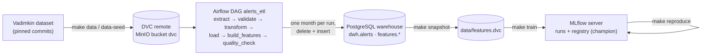

# Kyiv air-alert forecasting

Course project for KSE "Introduction to MLOps and ML System Design" (2026). The full design is in [docs/design.md](docs/design.md).

**Status:** Lab 2. Raw data versioned with DVC on MinIO, a monthly Airflow ETL with a quality gate, feature tables, rule baselines vs trained models on a time split, MLflow tracking and registry with lineage, one-command reproduction, and an optional Feast demo. Runs locally with Docker Compose; built and tested on Apple Silicon.

## Problem

Kyiv alerts are known only when the siren starts, with no estimate of when the next one comes or how long it lasts.
Twice a day (10:00 and 22:00) the system forecasts, for each of the next 12 hours, the probability that a Kyiv alert starts and the likely threat type.
When a Kyiv alert starts, it predicts how long the alert will last.
It learns from the public alert history of all Ukraine since 2022 and from the Ukrainian Air Force Telegram channel, retrains monthly and checks daily that the data has not changed.
Predictions are served by a REST API for planning only; the official alert always takes precedence.

## What the system predicts

| Model | Question | When it runs | Output | When we learn the truth |
|---|---|---|---|---|
| **M1** start risk | In which of the next 12 hours is a Kyiv alert likely to **start**? | 10:00 (for 10–22) and 22:00 (for 22–10) | one probability per hour | at the end of each hour |
| **M2** duration | This alert just started: when will it end? | the moment a Kyiv alert starts | **P50** "typically ends by" and **P90** "almost surely ends by" | when the alert ends |
| **M3** threat type | If an alert starts in that hour, what is it likely to be? | together with M1 | per hour: probability of drones, cruise missiles, ballistic | when an Air Force post names the type (Lab 3) |

Lab 2 builds M1 and M2 from alert data. M3 and the Telegram features need the Air Force posts, which arrive in Lab 3 together with the retrieval corpus.

**Why "starts in the hour".** 62% of Kyiv alerts cross an hour boundary. With "starts in the hour" every alert belongs to exactly one hour, so short alerts are never lost and long ones are never counted twice.

## How predictions are scored

Targets come from the Lab 1 analysis ([design.md §3](docs/design.md#3-success-metrics)); Lab 2 hold-out results are in [§5](#5-baseline-vs-model-time-split).

- **M1:** Brier score (main; how close the hourly probabilities are to what happened), AUC (do start hours get higher probabilities; 0.5 = random), F1 with ±1 h tolerance (flagging "high-risk" hours: an alert at 23:58 counts as caught by a 00:00 flag).
- **M2:** pinball loss for P50 and P90 (main: P90), share of alerts with P50 within ±15 min, **P90 kept** (share of alerts that ended before P90; target 85–95%), P90 width (median P90, shorter is more useful).
- **M3** (Lab 3): macro-F1 and log-loss against "always the most common type".

### Formulas

Brier score, over $N$ hours, where $p_i$ is the predicted probability that an alert starts in hour $i$ and $y_i$ is 1 if one did, 0 if not:

```math
\text{Brier} = \frac{1}{N}\sum_{i=1}^{N} (p_i - y_i)^2
```

Example: we said $p = 0.12$ and an alert started, so that hour scores $(0.12 - 1)^2 = 0.77$; a quiet hour with $p = 0.05$ scores $0.05^2 = 0.0025$.

Pinball loss for quantile $q$ ($q = 0.5$ for P50, $0.9$ for P90), real duration $y$ and prediction $\hat{y}$, averaged over alerts:

```math
L_q(y, \hat{y}) =
\begin{cases}
q\,(y - \hat{y}) & y \ge \hat{y} \quad \text{(alert lasted longer than predicted)} \\
(1 - q)\,(\hat{y} - y) & y < \hat{y} \quad \text{(alert ended earlier)}
\end{cases}
```

For P50 this is half the absolute error in minutes. For P90 = 240 min: an alert that ends after 90 min costs $0.1 \cdot 150 = 15$; one that lasts 300 min costs $0.9 \cdot 60 = 54$. Running past P90 costs 9× more per minute, so the score is best when about 1 alert in 10 outlasts P90.

## Lab 2 at a glance



Design details: [design.md §5.2–5.4, §6.1](docs/design.md#52-data).

## Quick start (clean clone)

Requirements: [uv](https://docs.astral.sh/uv/), Docker Desktop with **≥ 6 GB memory** (Settings → Resources), free ports 8080, 5001, 5433, 9000, 9001.

```bash
make setup     # Python 3.12 env from uv.lock (includes DVC 3.67.1 with dvc-s3 3.3.0)
make up        # copies .env.example to .env, builds and starts the stack, waits until healthy
make data      # dvc pull of the raw data + checksums  (on a new machine: make data-seed first)
make backfill  # alerts_etl for every month 2022-03 … 2026-09, oldest first (~7 min)
make snapshot  # export passed batches to data/features, dvc add + push
git add data/features.dvc && git commit -m "feature snapshot"
make train     # M1 + M2: baselines vs models, logged and registered in MLflow
make reproduce MODEL=kyiv-m1-start-risk ALIAS=champion
```

| UI | URL | Login |
|---|---|---|
| Airflow | http://localhost:8080 | none (local admin mode) |
| MLflow | http://localhost:5001 | none |
| MinIO console | http://localhost:9001 | `minioadmin` / `minioadmin123` (from `.env`) |

Every target in the [Makefile](Makefile) has a one-line comment. `make down` stops the stack and keeps its data; `make nuke` deletes all volumes.

### Notes for Apple Silicon

- Every image in [docker-compose.yml](docker-compose.yml) has an arm64 build; nothing runs under emulation.
- MLflow is on port **5001** because macOS AirPlay Receiver holds 5000. PostgreSQL is on **5433** so a Homebrew Postgres on 5432 does not clash.
- Models are scikit-learn `HistGradientBoosting*`; LightGBM / XGBoost are avoided because they need `libomp` from Homebrew.
- **Exit code 132** (illegal instruction in `cryptography`, older Docker Desktop): update Docker Desktop first. If that is not possible, uncomment the `cryptography==46.0.5` line in [docker/airflow/Dockerfile](docker/airflow/Dockerfile) and [docker/mlflow/Dockerfile](docker/mlflow/Dockerfile), then `make up`. This build did not need it (Docker Desktop with engine 29.2.1).
- `MLFLOW_ENABLE_PROXY_MULTIPART_DOWNLOAD=false` is set in `.env.example`, so `mlflow.*.load_model` on the host downloads through the tracking server instead of the unreachable `minio:9000`.
- All ports are bound to 127.0.0.1.

## 1. Data versioning

| | |
|---|---|
| Tool | DVC 3.67.1 + dvc-s3 3.3.0 |
| Remote | S3-compatible MinIO (`pgsty/silo`) in Docker Compose, bucket `dvc`: `s3://dvc`, endpoint `http://localhost:9000` ([.dvc/config](.dvc/config), committed). Credentials come from `.env` via the Makefile, never from git |
| Tracked | `data/raw/` → [data/raw.dvc](data/raw.dvc) (hash `352f88a87031f9e22af2cce021c2a4a7.dir`); training snapshot `data/features/` → `data/features.dvc` |
| Size | 40 MB in total, below the 200 MB limit, so **no sampling**: the files are the complete upstream files |

**Retrieve the data on a clean clone:**

```bash
make up      # MinIO must be running
make data    # = uv run dvc pull data/raw.dvc  &&  checksums
```

What arrives (md5, bytes):

```
e705cfc6d7054b8b09999be31c7c423c    31025633  data/raw/official_data_en.csv
938e6c53bd8f953198e1eafba1654822     9103166  data/raw/volunteer_data_en.csv
```

**New machine, empty MinIO:** `make data-seed` downloads both files from GitHub at their pinned commits (`58ee75b` official, `346bcff` volunteer), re-runs `dvc add` and fails unless the result is byte-identical to the committed `data/raw.dvc`, then `dvc push`es. After that `make data` works as above.

## 2. ETL pipeline: `alerts_etl`

[dags/alerts_etl.py](dags/alerts_etl.py) (thin) calls [src/kyiv_alerts/pipeline.py](src/kyiv_alerts/pipeline.py):

| Task | Does | Writes |
|---|---|---|
| `extract` | picks the source that covers the whole month (official file → volunteer file → alerts.in.ua API if a token is set) and stores the month's raw rows once; a rerun reuses that immutable copy | MinIO `lake/raw/alerts/YYYY-MM/<source>.csv` |
| `validate` | columns, timestamp parsing, known oblasts, every row inside the month, unfinished ≤ 1% | — (fails on a broken schema) |
| `transform` | exact duplicates, unfinished, end ≤ start; raion / hromada records merged into oblast episodes; counts per rule | MinIO `lake/clean/alerts/YYYY-MM.parquet` |
| `load` | **delete-then-insert of the month in one transaction**, plus the audit row | `dwh.alerts`, `dwh.batch_audit` |
| `build_features` | M1 and M2 feature rows for the month, as of issue time / alert start, using a 60-day lookback | `features.m1_hourly`, `features.m2_alert` |
| `quality_check` | the gate (§3 below) | `dwh.batch_audit.gate_passed` |

**The batch is the data interval, never the clock.** I chose the explicit timetable: `schedule=CronDataIntervalTimetable("@monthly", timezone="UTC")`, so each run has a real interval `[month start, next month start)` and the batch is the month of `data_interval_start`. A manual run can name the month with the `batch_month` param instead (`make run MONTH=2025-06` passes `{"batch_month": "2025-06"}`). No task reads `datetime.now()`.

```bash
make run MONTH=2025-06            # one month, waits for the result
make row-counts MONTH=2025-06     # rows for that month in each table + min/max start
make backfill FROM=2022-03 TO=2026-09
```

Triggering by logical date also works, with one Airflow subtlety: a *manual* run gets the interval that **ends** at its logical date, so `airflow dags trigger alerts_etl --logical-date 2025-07-01T00:00:00+00:00` processes June 2025 (scheduled and backfill runs are named by the interval start, e.g. `backfill__2025-07-01…` = logical date 2025-06-01 = June). The `batch_month` param avoids the ambiguity; in the UI use *Trigger* → *batch_month*.

**Only that interval:** after `make run MONTH=2025-06`, every row of the month has `started_at` between `2025-06-01` and `2025-06-30`:

```
$ make row-counts MONTH=2025-06
{
  "batch_month": "2025-06",
  "dwh.alerts": 1440,
  "features.m1_hourly": 720,
  "features.m2_alert": 34,
  "alerts_min_started_at": "2025-06-01 03:16:05+00:00",
  "alerts_max_started_at": "2025-06-30 22:03:45+00:00"
}
```

### Idempotency: the same interval run twice

The statement that makes a rerun harmless ([warehouse.py](src/kyiv_alerts/warehouse.py), `replace_batch`), executed for `dwh.alerts`, `features.m1_hourly` and `features.m2_alert` inside one transaction:

```sql
DELETE FROM dwh.alerts WHERE batch_month = %s;
INSERT INTO dwh.alerts (...) VALUES ...;
```

`make run MONTH=2025-06` twice, then `make row-counts MONTH=2025-06` after each run:

```
run 1: manual__2025-06__20261024T205222  success
  dwh.alerts 1440 · features.m1_hourly 720 · features.m2_alert 34
  started_at 2025-06-01 03:16:05+00:00 … 2025-06-30 22:03:45+00:00

run 2: manual__2025-06__20261024T205240  success
  dwh.alerts 1440 · features.m1_hourly 720 · features.m2_alert 34
  started_at 2025-06-01 03:16:05+00:00 … 2025-06-30 22:03:45+00:00
```

### Sources

- **Official file** (commit `58ee75b`): months 2022-03 … 2026-08.
- **Volunteer file** (commit `346bcff`): months the official file does not cover — 2026-09.
- **alerts.in.ua** (`ALERTS_IN_UA_TOKEN` in `.env`): months no pinned file covers. `month_ago` returns only the last 30 days, so a month has to be fetched within 30 days of its end; the JSON is kept in the lake as fetched and reused on rerun. `make api-smoke` checks the token with one request.

### Backfill result

`make backfill FROM=2022-03 TO=2026-09`: 55 monthly runs, ~7 minutes, **53 passed the gate, 2 failed for real reasons** (below). `dwh.batch_audit` keeps the source, raw sha256, row counts per cleaning rule and the gate report of every month:

```sql
-- docker compose exec postgres psql -U warehouse -d warehouse
SELECT batch_month, source, rows_raw, rows_duplicate, rows_bad_time, rows_clean, m1_rows, m2_rows, gate_passed
FROM dwh.batch_audit ORDER BY batch_month;
```

Unpausing the DAG also makes Airflow schedule the latest complete interval (2026-09) right away; if that run comes before the backfill it fails on `previous_batch_rows` (no lookback yet), and the backfill reruns it.

## 3. Quality gate

[src/kyiv_alerts/quality.py](src/kyiv_alerts/quality.py). Thresholds were set from the 2022-03 … 2026-07 official batches, where invalid records were ≤ 0.02%, batch size stayed within 0.61–1.40× of the trailing median and the newest alert was ≤ 4.3 h before month end.

| Check | Limit |
|---|---|
| invalid records (unfinished or end ≤ start) after de-duplication | ≤ 1% |
| clean rows vs median of the last 3 passed batches | within ±50% |
| duplicate (oblast, start) in the warehouse | 0 |
| hours between the newest alert and month end | ≤ 48 |
| Kyiv alerts in the month | ≥ 1 |
| previous month loaded (feature lookback) | > 0 rows |
| M1 rows = hours in the month; M2 rows = Kyiv alerts | equal |
| feature nulls; single `feature_version` | 0; `v1` |

A failed batch fails the run, is marked in `dwh.batch_audit`, and is left out of the training snapshot.

**Tested on purpose.** `make bad-batch` writes [scripts/make_bad_batch.py](scripts/make_bad_batch.py)'s broken copy of June 2025: the schema is intact (so `validate` passes), but 30% of rows (seed 7) get an end 5 minutes before their start. It is fed to the DAG through the `raw_override` param, `transform` drops those rows, and `quality_check` fails:

```
$ make bad-batch
data/fixtures/bad_batch_2025-06.csv: 4874 rows, 1500 with end before start
triggered manual__2025-06__20261024T205309  conf={"batch_month": "2025-06", "raw_override": "/opt/airflow/data/fixtures/bad_batch_2025-06.csv"}
manual__2025-06__20261024T205309: failed

extract success · validate success · transform success · load success · build_features success · quality_check FAILED

transform: {'rows_raw': 4874, 'rows_duplicate': 1389, 'rows_unfinished': 0, 'rows_bad_time': 1274, 'rows_valid': 2211, 'rows_clean': 1346, 'invalid_share': 0.3656}
quality_check log:
  FAIL invalid_share: 0.3656 (limit <= 0.01)
  PASS rows_vs_3m_median: 0.996 (limit 1 ± 0.5)
  PASS duplicate_episodes: 0 (limit == 0)
  PASS hours_since_newest_alert: 1.9 (limit <= 48)
  ... (6 more PASS)
  AirflowFailException: batch 2025-06 failed: invalid_share=0.3656 (limit <= 0.01)
```

`make run MONTH=2025-06` restores the month afterwards.

| Failed gate | Successful run |
|---|---|
|  |  |

**Caught for real:** the backfill stopped two real batches.

| Batch | Failed check | Why |
|---|---|---|
| 2026-08 | `hours_since_newest_alert` = 67.1 (limit 48) | the official file has no alerts after 2026-08-29 05:00 UTC, while the volunteer file has ~170 a day: an upstream gap, the "stale extract" case |
| 2026-09 | `rows_vs_3m_median` = 2.20 (limit 1 ± 0.5) | the only source is the volunteer file, which splits alerts into ~2× more oblast episodes than the official one: a source switch |

Note the bad batch passed the size check (0.996), because merged episodes hide dropped records. That is why the gate checks the invalid share separately.

Both stay out of training. alerts.in.ua data (raion level, like the official file) is the planned replacement once the token is set.

## 4. Feature tables

`features.m1_hourly` (one row per hour) and `features.m2_alert` (one row per Kyiv alert), each with `feature_version = v1` and the label alongside. The serving-time source of every feature is in [design.md §5.3](docs/design.md#53-techniques). All features come from one module, [src/kyiv_alerts/features.py](src/kyiv_alerts/features.py), that Lab 4's service will reuse on live state.

**Optional: Feast point-in-time demo.** [feature_repo/](feature_repo/) defines entity `city` and feature view `kyiv_state` (the issue-time M1 inputs, one row per 10:00 / 22:00 issue) over the exported snapshot. `make feast-demo` asks for the state at a time between two rows and checks that Feast returns the earlier one:

```
$ make feast-demo
feature row A at 2026-07-22 10:00:00+03:00: {'oblasts_under_alert_at_issue': 6, 'kyiv_under_alert_at_issue': 0, 'days_since_long_alert': 16.20, 'kyiv_alert_min_prev_12h': 5.4, 'oblast_starts_prev_12h': 33}
feature row B at 2026-07-22 22:00:00+03:00: {'oblasts_under_alert_at_issue': 8, 'kyiv_under_alert_at_issue': 0, 'days_since_long_alert': 16.70, 'kyiv_alert_min_prev_12h': 22.2, 'oblast_starts_prev_12h': 35}
requested at     2026-07-22 16:00:00+03:00
Feast returned   {'oblasts_under_alert_at_issue': 6.0, 'kyiv_under_alert_at_issue': 0.0, 'days_since_long_alert': 16.20, 'kyiv_alert_min_prev_12h': 5.4, 'oblast_starts_prev_12h': 33.0}
point-in-time correct (returned the earlier row A): True
```

## 5. Baseline vs model (time split)

Train 2023-01-01 … 2026-02-28, hold-out 2026-03-01 … 2026-07-31 (2026-08 failed the gate). Why a time split and these dates: [design.md §5.4](docs/design.md#54-experimentation-and-validation). Lower is better for Brier, log-loss and pinball.

Training data version `data_version = 3cf8df9332fabe0ad5a9ffed307af367.dir` (batches 2022-03 … 2026-07 that passed the gate).

**M1 — start risk**, 3,672 hold-out hours, an alert started in 6.3% of them. Train: 27,720 hours.

| | Brier ↓ (main) | AUC ↑ | log-loss ↓ | F1 ±1 h ↑ |
|---|---|---|---|---|
| Trivial: start rate by hour of day | 0.0592 | **0.562** | 0.2360 | **0.307** |
| Rule: same hour, last 30 days | 0.0607 | 0.514 | 0.3187 | 0.291 |
| Model: HistGradientBoostingClassifier | **0.0589** | 0.561 | **0.2342** | **0.307** |

The model beats both baselines on Brier and log-loss, but only by 0.0003 Brier over the hour-of-day profile, and it ties it on AUC and F1. The 30-day rule is worse than the trivial profile: one month of history is too noisy per hour. Alert history alone barely predicts *when* an alert starts; AUC stays below the 0.60 target. The Telegram features (Lab 3) are the bet.

**M2 — duration**, 237 hold-out Kyiv alerts with a known end. Train: 1,413 alerts.

| | pinball P50 ↓ | pinball P90 ↓ (main) | P50 within ±15 min ↑ | P90 kept (target 85–95%) | P90 width ↓ |
|---|---|---|---|---|---|
| Rule: last-12-months P50 / P90 (33 / 224 min) | **15.96** | 21.67 | **49.4%** | 97.0% | 224 min |
| Model: quantile HistGradientBoosting | 17.19 | **15.16** | 38.0% | 95.4% | **138 min** |

The model wins the main metric: P90 pinball is 30% lower, and P90 shrinks from 224 to 138 min while still holding for 95.4% of alerts. **The rule beats the model on P50**: a constant 33 min is closer to the typical alert than the model's median. A production M2 would take P90 from the model and P50 from the rule until a better P50 model exists.

## 6. Experiment tracking and the registry

MLflow 3.16.1 at http://localhost:5001: backend store PostgreSQL (database `mlflow`), artifact store MinIO (bucket `mlflow`, served through the tracking server). Started by `make up`.

Every `make train` run logs:

- **params:** split dates, seed, hyperparameters, feature list ([configs/train.yaml](configs/train.yaml));
- **metrics:** every baseline and the model side by side (`holdout_<metric>_<trivial|rule|model>`);
- **tags:** `data_version` (DVC hash of `data/features`), `raw_data_version` (DVC hash of `data/raw`), `git_commit`, `git_dirty`, `feature_version`.

Training refuses to run with uncommitted changes or with `data/features` out of sync with `data/features.dvc`, so the two lineage tags always identify what built the model. Each run registers a version of `kyiv-m1-start-risk` / `kyiv-m2-duration` with `data_version` and `git_commit` copied onto the version; the first version gets the alias **`champion`** (`make train CHAMPION=1` moves it), which Lab 4 loads as `models:/kyiv-m1-start-risk@champion`.

### Reproduce a registered run

```bash
make reproduce MODEL=kyiv-m1-start-risk ALIAS=champion   # or VERSION=3
make reproduce MODEL=kyiv-m2-duration ALIAS=champion
```

[src/kyiv_alerts/reproduce.py](src/kyiv_alerts/reproduce.py) reads `git_commit` and `data_version` from the model version, checks out that commit in a temporary `git worktree` (your working tree is untouched), verifies that its `data/features.dvc` has hash `data_version`, `dvc pull`s it from MinIO, runs that commit's training without registering (tagged `reproduces=<run id>`), and compares the main metric.

**On another machine** the snapshot is not in that machine's MinIO yet: run `make data-seed`, `make backfill` and `make snapshot` first. The export is deterministic (sorted rows, same lock file), so it reproduces the same `data/features.dvc` hash and pushes the data the registered version needs.

**Tolerance:** |Δ Brier| ≤ 1e-4 for M1, |Δ pinball@0.9| ≤ 0.1 min for M2. On the same machine and lock file the difference is 0 (fixed seed, early stopping off); the tolerance covers floating-point differences between CPUs and BLAS builds.

```
$ make reproduce MODEL=kyiv-m1-start-risk ALIAS=champion
kyiv-m1-start-risk v1: run <run id>, commit <git_commit>, data 3cf8df9332fabe0ad5a9ffed307af367.dir
$ git worktree add --detach /tmp/kyiv-repro-…/repo <git_commit>
$ dvc pull data/features.dvc
A       data/features/
$ uv run --frozen python -m kyiv_alerts.train --model m1 --no-register --reproduces <run id> …
$ git worktree remove --force /tmp/kyiv-repro-…/repo
holdout_brier_model: registered 0.058906, reproduced 0.058906, |diff| 0.00e+00 (tolerance 0.0001) -> PASS

$ make reproduce MODEL=kyiv-m2-duration ALIAS=champion
...
holdout_pinball_90_model: registered 15.159839, reproduced 15.159839, |diff| 0.00e+00 (tolerance 0.1) -> PASS
```

## Repository

```
dags/alerts_etl.py            Airflow DAG (thin wrapper)
src/kyiv_alerts/              pipeline, sources, cleaning, features, gate, training, reproduction
  sql/warehouse.sql           warehouse schema (dwh, features)
configs/train.yaml            split dates and hyperparameters
feature_repo/                 Feast offline demo (optional)
scripts/                      seeding, bad batch, Airflow run / backfill helpers
docker/                       Airflow and MLflow images, Postgres init
docker-compose.yml            local stack
data/raw.dvc, data/features.dvc   data versions (contents live in the DVC remote)
docs/design.md                design document
tests/                        unit tests (no Docker needed): make test
```

## Maturity scorecard

| Property | Evidence a reviewer checks | Added in |
|---|---|---|
| Repository reproducible from a clean clone | CI is green; `make setup` and `make lint` succeed on a fresh clone | Lab 1 |
| Design document exists and is current | [`docs/design.md`](docs/design.md) follows the template, every section filled or marked as an assumption | Lab 1 |
| Data versioned | `make data` retrieves the raw data on a clean clone with the checksums in [§1](#1-data-versioning) | Lab 2 |
| Pipeline idempotent | the same month run twice gives identical row counts, both pasted in [§2](#idempotency-the-same-interval-run-twice) | Lab 2 |
| Quality gate present | `make bad-batch` fails `quality_check` on purpose; output and screenshot in [§3](#3-quality-gate) | Lab 2 |
| Experiments tracked | every run in MLflow (http://localhost:5001) has params, metrics, `data_version` and `git_commit` ([§6](#6-experiment-tracking-and-the-registry)) | Lab 2 |
| Model registered with lineage | `kyiv-m1-start-risk@champion` / `kyiv-m2-duration@champion` tagged with data version and commit; `make reproduce` passes within the stated tolerance ([§6](#reproduce-a-registered-run)) | Lab 2 |
