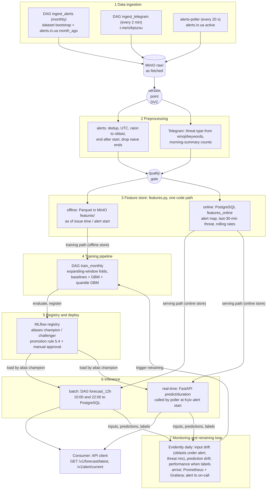
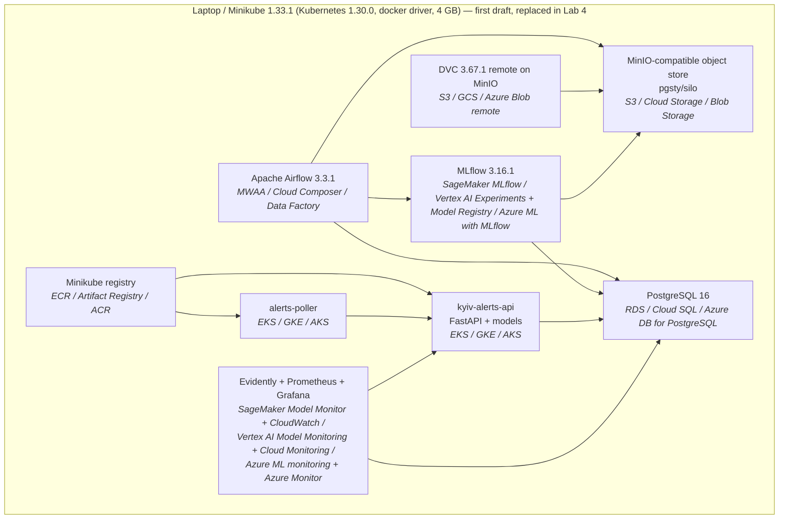

# Kyiv air-alert forecasting — design document

Author: Kvitoslava Yarish · Course: KSE Introduction to MLOps and ML System Design, 2026 · Status: Lab 1 (design)

Template: [eugeneyan/ml-design-docs](https://github.com/eugeneyan/ml-design-docs). Section numbers are fixed; later labs revise sections by these numbers. Items marked **Assumption** are design decisions taken without full information and are revisited in the lab named next to them.

---

## 1 Overview

Kyiv residents and businesses plan their days and nights around air-raid alerts, but they learn about an alert only when the siren starts and never know how long it will last.
The system issues a 12-hour forecast twice a day (10:00 and 22:00 Kyiv time) with the probability of an alert in each hour of the window and the likely threat type (drones, cruise missiles, ballistic), and predicts the duration of every Kyiv alert (median and 90th percentile) the moment it starts.
It learns from the public history of air-raid alerts across Ukraine since 2022 and from the Ukrainian Air Force's public Telegram channel, and it retrains as new alerts and posts arrive.
The desired outcome is a planning aid served through a REST API that is measurably better than simple hour-of-day and recent-history baselines and that notices when attack patterns change; the official alert always takes precedence over the model.

## 2 Motivation

**Why a system and not a notebook.** Alert patterns are not stationary. In our data, the share of nights with at least 60 minutes of alert in Kyiv moved from 21% (2023) to 41% (2025) and back to 29% (2026), the median alert got shorter (55 → 30 min), and in November 2025 alerts across Ukraine switched from oblast-level to raion-level announcements. A model fitted once in a notebook is wrong within months. The value comes from re-ingesting new alerts every day, retraining on a schedule, and detecting when the inputs change.

**Who consumes the predictions, and how often.**

| Prediction | Consumer | Frequency |
|---|---|---|
| M1: 12-hour hourly alert probabilities | API clients: a planning app or bot (later), the Lab 5 agent | twice a day (10:00, 22:00), read many times |
| M2: duration of the current alert (P50, P90) | same API clients | at every Kyiv alert start, about 1.4 times a day (511 alerts in 2025) |

**What happens when they are wrong.**

- M1 says low risk and a long night alert happens: a user who planned around the forecast is disrupted (meeting, delivery, sleep). Cost is inconvenience, not safety, because the siren still sounds.
- M1 says high risk and nothing happens: users over-prepare; repeated false alarms erode trust and people stop using the forecast.
- M2 P90 is too short: a user leaves shelter planning too early or schedules something that gets interrupted. This is the more harmful error, so M2 is evaluated on whether P90 is kept, not only on average error.
- Safety framing: every response states that it is a planning estimate and that the official alert overrides it. The system never advises whether to go to a shelter.

## 3 Success metrics

Three layers, kept apart. Each has a target or a stated assumption.

| Layer | M1: 12-hour forecast | M2: alert duration |
|---|---|---|
| **Business** (decision) | **Warned share:** of 12-hour windows with ≥ 60 min of Kyiv alert, at least **60%** are flagged high-risk in advance while at most **30%** of quiet windows are flagged. **Assumption:** 60/30 is the trade-off a planner accepts; revisited with consumers in Lab 4. Current evidence: history-only GBM reaches 59% at 30%; the hour-of-day baseline cannot separate windows at all (0%). | **P90 kept:** at least **90%** of Kyiv alerts end before the predicted P90, **and** the median predicted P90 is narrower than the baseline's 224 min (last-12-months P90). |
| **Model** (offline) | **Brier score** on hourly probabilities (optimising). **AUC ≥ 0.60** on hourly labels (satisficing). Baselines on the 2026-03…2026-09 hold-out: hour-of-day climatology Brier 0.0981 / AUC 0.578. | **Pinball loss** at q = 0.5 and q = 0.9 (optimising). **P90 coverage 85–95%** (satisficing). Baseline (last-12-months median): MAE 34.6 min. |
| **System** | Forecast published **≤ 5 min** after 10:00 / 22:00. Feature freshness at issue time: alert map ≤ 30 s old, Telegram ≤ 5 min old. | Prediction available **≤ 60 s (p95)** after the alert starts in the alerts.in.ua feed. API p95 latency ≤ 200 ms. |

**M3 (threat type, part of the M1 output):** model metric = multiclass log-loss of the type probabilities (optimising), compared with a baseline that always predicts last month's type mix; no separate business metric.

Optimising vs satisficing: Brier, pinball loss and log-loss are minimised; AUC, P90 coverage, freshness and latency only have to clear their thresholds.

## 4 Requirements and constraints

### 4.1 Functional requirements

| # | Requirement |
|---|---|
| F1 | **Inputs:** finished Kyiv and Ukraine-wide alert intervals (history and monthly), currently active alerts (polled every 20 s), Air Force Telegram posts (scraped every 2 min). |
| F2 | **M1 + M3 output:** at 10:00 and 22:00 Kyiv time, for the next 12 hours: 12 hourly probabilities that Kyiv is under alert for ≥ 10 min of that hour, a risk band per hour, the threat-type probabilities if an alert happens, window summary (P(≥ 60 min of alert), expected alert-hours, P(any drone alert), P(any missile/ballistic alert)), `model_version`, `issued_at`, `degraded` flag. Format in 5.1. |
| F3 | **M2 output:** when a Kyiv alert starts: predicted duration P50 and P90 in minutes, threat type used, `model_version`, `alert_started_at`, `degraded` flag. |
| F4 | **Who calls:** any API client, read-only: `GET /v1/forecast/latest`, `GET /v1/alert/current`, `GET /v1/health`. The internal `POST /v1/predict/duration` is called only by the alerts poller inside the cluster. |
| F5 | **Fallback:** if a model, a feature or a data source is unavailable, the API returns the baseline prediction with `degraded: true` instead of an error. |
| F6 | **Labels:** every prediction is joined with its outcome once known (window end for M1, alert end for M2) and stored for monitoring and retraining. |

### 4.2 Non-functional requirements

One row per category; every row carries a number or an explicit assumption.

| Category | Requirement |
|---|---|
| **Freshness** | M1 published ≤ 5 min after issue time. Active-alert state ≤ 30 s old (20 s poll). Telegram posts ingested ≤ 5 min after publication (2-min scrape). Finished-alert labels ingested monthly for training (alerts.in.ua `month_ago`), daily for monitoring. |
| **Latency and throughput** | API p95 ≤ 200 ms (reads precomputed rows). M2 end-to-end ≤ 60 s p95 from alert start. Load: **Assumption** ≤ 10 requests/s peak (single consumer and demo); about 2 M1 runs and ~1.4 M2 predictions per day. External limits: alerts.in.ua ≤ 8 requests/min (hard limit 12/min; history endpoint 2/min). |
| **Availability and fallback** | **Assumption:** 99% monthly availability on the local Minikube deployment (laptop may sleep). Fallback per F5: hour-of-day climatology for M1, last-12-months median/P90 for M2. If alerts.in.ua is unreachable for > 2 min, M2 is marked `degraded` and `/v1/health` reports the stale source. |
| **Reproducibility** | Every registered model is traceable to a DVC data version, a git commit and its parameters in MLflow; re-running training with the same data version and commit gives identical metrics (fixed seeds). The environment is pinned with `uv.lock`; `make setup` rebuilds it from a clean clone. |
| **Adaptability** | New month of alerts and posts is ingested by one DAG run. Retraining is monthly on an expanding window, plus on demand when monitoring fires. A new model or feature enters as `challenger` and is promoted only by the rule in 5.4. |
| **Observability without ground truth** | Labels arrive late: up to 12 h for M1 (window end) and up to ~11 h for M2 (longest alert 673 min; P99 440 min). Before labels arrive we monitor input drift (oblasts-under-alert distribution, Telegram threat-type mix and post volume), prediction drift (mean predicted probability, mean predicted P90) and data freshness. |
| **Cost and resource ceilings** | Local: laptop with Minikube at 4 GB RAM (course reference), no GPU. Cloud: estimated in 6.7, **Assumption** ceiling $200/month for the self-hosted-on-Kubernetes variant. External: free tiers only (alerts.in.ua token, public Telegram preview). |

### 4.3 In scope

- Kyiv City only (other oblasts are inputs, not targets).
- M1 (12-hour hourly forecast at 10:00 and 22:00) and M2 (duration at alert start).
- Data from two sources: air-alert data (dataset + alerts.in.ua API) and the Air Force Telegram channel.
- REST API as the only consumer interface.

### 4.4 Out of scope

- Safety advice (whether to go to a shelter), push notifications to the public, a user-facing app.
- Predicting targets, strike locations, damage, or anything about air-defence positions.
- Red/yellow alert levels as a target: alerts.in.ua exposes them only for current alerts, so we start collecting them in Lab 2 but do not model them yet.
- Weather features (rejected with evidence, see 7.1).

**Conditional scope:** the threat-type forecast (M3) is in scope, but depends on Telegram type labels being reliable. **Assumption:** at least 80% of Kyiv alerts since 2024 can be matched to an Air Force post with a recognised threat type; checked in Lab 2. If the check fails, the API returns P(alert) without type probabilities and M3 moves to future work.

## 5 Methodology

### 5.1 Problem statement

- **M1: probabilistic classification, one row per (issue time, hour ahead).** For issue time *t* ∈ {10:00, 22:00} and lead *h* ∈ {0…11}, predict P(Kyiv under alert ≥ 10 min during hour *t + h*). Window summaries (P(≥ 60 min), expected minutes) are derived from the 12 hourly probabilities. One model serves both issue times; issue time and lead are features.
- **M2: quantile regression.** At the start of a Kyiv alert, predict the 0.5 and 0.9 quantiles of its duration in minutes.
- **M3: multiclass classification, conditional on an alert.** For each hour of the M1 window, predict P(type | alert) over three classes: **drones** (Shahed-type and jet drones), **cruise missiles**, **ballistic**. Labels come from Air Force posts matched to each Kyiv alert. Guided bombs (КАБ) do not reach Kyiv and are not a class. At alert start, the observed type from Telegram is an *input* to M2, not a prediction.

**Prediction outputs**

M1 + M3, example for the 22:00 issue. The P(alert) column is what the **baseline** predicts today (2025–26 share of hours with a Kyiv alert, by hour of day); the trained model shifts each hour from these values. The type columns are illustrative until M3 is trained.

| Hour (Kyiv) | P(alert) | Risk | P(drones \| alert) | P(cruise \| alert) | P(ballistic \| alert) |
|---|---|---|---|---|---|
| 22–23 | 12% | 🟡 | 0.80 | 0.12 | 0.08 |
| 23–00 | 18% | 🟡 | 0.82 | 0.11 | 0.07 |
| 00–01 | 23% | 🔴 | 0.84 | 0.10 | 0.06 |
| 01–02 | 27% | 🔴 | 0.82 | 0.12 | 0.06 |
| 02–03 | 23% | 🔴 | 0.75 | 0.17 | 0.08 |
| 03–04 | 21% | 🔴 | 0.60 | 0.28 | 0.12 |
| 04–05 | 18% | 🟡 | 0.45 | 0.35 | 0.20 |
| 05–06 | 15% | 🟡 | 0.40 | 0.30 | 0.30 |
| 06–07 | 13% | 🟡 | 0.35 | 0.25 | 0.40 |
| 07–08 | 12% | 🟡 | 0.30 | 0.20 | 0.50 |
| 08–09 | 8% | 🟢 | 0.25 | 0.15 | 0.60 |
| 09–10 | 8% | 🟢 | 0.25 | 0.15 | 0.60 |

Window summary: P(≥ 60 min of alert) 0.33 · expected alert-hours 2.0 · P(any drone alert) 0.28 · P(any missile/ballistic alert) 0.10.

Risk bands per hour: 🟢 < 10%, 🟡 10–20%, 🔴 ≥ 20% (the average hour has 11%).

```json
{
  "issued_at": "2026-10-24T22:00:00+03:00",
  "window": {"start": "2026-10-24T22:00:00+03:00", "end": "2026-10-25T10:00:00+03:00"},
  "hours": [
    {"hour_start": "2026-10-24T22:00:00+03:00", "p_alert": 0.12, "risk": "elevated",
     "type_if_alert": {"drones": 0.80, "cruise_missiles": 0.12, "ballistic": 0.08}}
  ],
  "summary": {"p_alert_60min": 0.33, "expected_alert_hours": 2.0,
              "p_any_drones": 0.28, "p_any_missiles_or_ballistic": 0.10},
  "model_version": {"m1": "m1-hourly@champion:7", "m3": "m3-type@champion:2"},
  "degraded": false,
  "disclaimer": "Planning estimate. The official alert always takes precedence."
}
```

M2, at the start of a Kyiv alert:

```json
{
  "alert_started_at": "2026-10-24T23:41:10+03:00",
  "threat_type": "drones",
  "threat_source": {"channel": "kpszsu", "post_id": 90211, "posted_at": "2026-10-24T23:36:02+03:00"},
  "duration_min": {"p50": 95, "p90": 240},
  "expected_end": {"p50": "2026-10-25T01:16:00+03:00", "p90": "2026-10-25T03:41:00+03:00"},
  "model_version": "m2-duration@champion:3",
  "degraded": false
}
```

**Rejected framing: one binary label per night** ("will there be ≥ 60 min of alert in Kyiv tonight?"). It is simpler, but the 60-minute threshold is arbitrary, it says nothing about *when* during the night, and it needs a second model for the day. The hourly framing gives timing, covers day and night with one model, and the window-level answer falls out of it.

**Also rejected: M2 as classification into duration buckets** (< 30 min, 30–120, > 120). Buckets lose the tail that matters for planning; quantiles keep it.

### 5.2 Data

**Sources and arrival pattern**

| Source | Content | Arrival | Role |
|---|---|---|---|
| [Vadimkin/ukrainian-air-raid-sirens-dataset](https://github.com/Vadimkin/ukrainian-air-raid-sirens-dataset) (MIT), `official_data_en.csv` | All official alerts since 2022-03-15, UTC start/end, oblast/raion/hromada level | Bootstrap once; repo says "updated daily" but our copy ends **2026-09-07** | Training history and labels |
| Same repo, `volunteer_data_en.csv` | Alerts since 2022-02-25, oblast level, collected from eTryvoga | Current to 2026-10-23 | Cross-check; fills months after 2026-09-07 |
| [alerts.in.ua API](https://devs.alerts.in.ua/) | Active alerts (`/v1/alerts/active.json`, IoT v2 with red/yellow), last month of finished alerts (`/v1/regions/{uid}/alerts/month_ago.json`) | Active: poll every 20 s. History: monthly batch | Live features (serving), monthly batches and labels going forward |
| Telegram [@kpszsu](https://t.me/s/kpszsu) (Ukrainian Air Force), public web preview | Short typed posts: emoji + threat type + location + heading (e.g. "🛵 Ударні БпЛА … курсом на …"); morning summaries with counts of drones and missiles | ~10+ posts/hour during attacks; scraped every 2 min; history back-filled from 2024-01-01 | Threat-type features, attack-size features, M2 threat type, Lab 3 corpus |

**Labels and their delay**

- M1 hourly label: Kyiv under alert ≥ 10 min in that hour → known at the end of the hour; the whole window is labelled 12 h after issue.
- M2 label: alert duration → known when the alert ends (median 38 min, P90 161 min, P99 440 min, max 673 min).

**Available at serving time vs training time**

| Information | Training (offline) | Serving (online) |
|---|---|---|
| Alert intervals | complete start + end from the dataset | only *started* alerts are known; ends arrive later |
| Oblasts under alert at time *t* | reconstructed from dataset intervals | current snapshot from alerts.in.ua active endpoint (different producer) |
| Telegram posts | scraped history: **current** (possibly edited) text | text as first published |
| Alert level red/yellow | not available | available (collected from Lab 2, not used yet) |

**Data quality findings (measured, Lab 1)**

- 38% of rows in `official_data_en.csv` are exact duplicates (113,845 rows); Kyiv: 4,141 rows → 2,267 alerts after de-duplication.
- The official file stopped updating on 2026-09-07 despite "updated daily" → freshness check needed (6.6).
- Since November 2025 almost all alerts are raion-level (oblast-level rows fell from ~700/month to < 60/month). The raw number of active alert records jumped from 18.7 to 28.9 per hour (Oct → Nov 2025), but after aggregating raions back to oblasts the feature "oblasts under alert" stayed at 6.2–6.4. Aggregation is therefore part of preprocessing, and the raw record count is monitored as an upstream-change signal (6.6).
- Volunteer data: 8.6% of Kyiv rows have no recorded end and a guessed `+30 min` end (`naive=True`) → excluded from M2 labels.
- Yearly Kyiv alert counts agree between official and volunteer data within ~5% (2023–2025).

**Storage formats**

- Raw layer: exactly as fetched (CSV from GitHub, JSON from alerts.in.ua, CSV parsed from the Telegram preview) in MinIO `raw/`, partitioned by source and date. Raw is never edited, so any bug in preprocessing can be replayed.
- Clean and feature layers: Parquet in MinIO (columnar, typed, compressed, fast for time-range scans in training).
- Serving layer: PostgreSQL tables (current alert state, online features, forecasts, predictions joined with labels) because the API needs indexed point lookups and the poller needs transactional writes.

**Checklist justification (step 1 of the lab)**

| Item | Justification |
|---|---|
| **A time axis** | Every alert has UTC start and end since 2022; every post has a UTC timestamp. Lab 2 ingests "the next month" from alerts.in.ua `month_ago` plus newly scraped posts. Lab 4 can replay real drift: the November 2025 raion switch and the 2025 rise in long night alerts. |
| **Enough history to hold out a period** | 4.5 years of alerts (2,267 Kyiv alerts; ~1,300 nights). Final hold-out: 2026-03-01 → 2026-08-31 (6 months, 4,536 hourly rows for M1, 349 alerts for M2). Telegram is back-filled from 2024-01-01, so models that use Telegram train on 2024-01 → 2026-02 (26 months). |
| **Labels with a known arrival delay** | M1: 1–12 h (end of the hour / end of the window). M2: end of the alert, ≤ 11.2 h observed. Both are much shorter than the monthly retraining cycle, so Lab 4 monitors performance on the same day, not a quarter later. |
| **A text surface** | The Air Force Telegram channel (tens of thousands of posts since 2024) is both a feature source and the Lab 3 retrieval corpus: "what is the current threat to Kyiv and why does the forecast say so?" grounded in recent posts and morning summaries. |

### 5.3 Techniques

**Baselines first (rule or trivial model), then the candidate.** A candidate is useful only if it beats the rule baseline, not just the trivial one.

| | Trivial baseline | Rule baseline | Candidate |
|---|---|---|---|
| M1 | P(alert hour) by hour of day from training data. Hold-out: Brier 0.0981, AUC 0.578 | Same hour's alert rate over the last 30 days. Hold-out: Brier 0.0984, AUC 0.584 | Gradient-boosted trees (LightGBM / sklearn HistGradientBoosting), later logistic regression for comparison. First history-only version: Brier 0.0946, AUC 0.636 (AUC 0.79 at lead 0 h) |
| M2 | Last-12-months median and P90 (33 / 224 min). Hold-out MAE 34.6 min, P90 coverage 0.97 | By threat type at start, from Telegram: ballistic → short, drones → long (to be measured in Lab 2) | Quantile gradient boosting (q = 0.5, 0.9). A naive first version scored MAE 45.1 (worse than baseline: drift + raion switch), so features are rebuilt as raion-aware |

**Features and where each value comes from at serving time**

| Feature | Model | Training source | Serving source |
|---|---|---|---|
| hour of day, lead, issue time, day of week, holiday flag | M1 | computed from timestamp | computed from timestamp |
| moon illumination | M1 | astronomical formula | same formula |
| Kyiv alert rate in the same hour, last 30 days | M1 | clean alert table (Parquet) | same feature code on PostgreSQL alert table |
| Kyiv alert minutes in the previous window | M1 | clean alert table | PostgreSQL alert table |
| days since last massive night (≥ 180 min of alert) | M1 | clean alert table | PostgreSQL alert table |
| Kyiv currently under alert | M1 | reconstructed from intervals at *t* | poller state (alerts.in.ua active) |
| **number of oblasts under alert now** (raion alerts aggregated to oblast) | M1, M2 | reconstructed from dataset intervals | alerts.in.ua active snapshot ← **different producer from training** |
| oblasts that started an alert in the last 5 / 60 min | M2 | dataset intervals | poller history in PostgreSQL |
| minutes since Kyiv oblast (Kyivska) alert started | M2 | dataset intervals | poller state |
| minutes since previous Kyiv alert ended | M2 | clean alert table | PostgreSQL alert table |
| count of Air Force posts by threat type (drones / jet drones / missiles / ballistic / guided bombs) in last 6 h and 12 h, and mentions of Kyiv | M1 | scraped posts, `datetime_utc < t` | live Telegram ingest |
| drones and missiles in last night's morning summary | M1 | parsed summaries | parsed live summary |
| threat type in the 30 min before alert start | M2 | scraped posts | live Telegram ingest |

Two features have a serving source different from their training source: "oblasts under alert now" (Vadimkin dataset vs alerts.in.ua live) and every Telegram feature (edited history vs first-published text). Both are monitored for training–serving skew (6.6). All features are computed by one Python module used by both the offline and the online path.

### 5.4 Experimentation and validation

- **Split by time, never at random.** Alerts come in waves: consecutive hours and nights are strongly correlated, so a random split puts the same attack into train and test and inflates scores (leakage).
- **Folds:** expanding window with monthly test folds (train on everything before month *m*, test on month *m*). **Final hold-out:** 2026-03-01 → 2026-08-31, touched once per model family.
- **As-of discipline:** every feature is computed only from data with timestamp < issue time (M1) or < alert start (M2); Telegram posts filtered by `datetime_utc`.
- **Offline metrics:** M1 Brier (main), log-loss, AUC, reliability curve, per-lead Brier. M2 pinball loss at 0.5 and 0.9 (main), MAE, P90 coverage.
- **Comparing a new model with the current one (champion/challenger):** both scored on the same last 3 monthly folds; the challenger must be better on the main metric with a day-level bootstrap 95% interval that excludes zero, must not break any satisficing threshold, and must beat the rule baseline. Then it runs one week in shadow mode (predictions logged, not served) before manual promotion.

### 5.5 Human in the loop

- **Drift alert:** goes to the on-call engineer (the author). Within 24 h they open the Evidently report and choose: ignore (documented), retrain, or switch to baseline.
- **Model promotion:** never automatic. The on-call engineer reviews the comparison report (5.4) and moves the MLflow alias `champion` to the new version.
- **Override:** setting `FORCE_BASELINE=true` (environment variable / Kubernetes ConfigMap) makes the API serve baseline predictions with `degraded: true`; pinning the `champion` alias to an older version rolls back the model.

## 6 Implementation

### 6.1 High-level design

#### System context


#### Data flow on the seven layers

The three marks: **version point** (DVC snapshot of `raw/` after ingestion), **quality gate** (before the feature store), and the split between the **training path** (offline store) and the **serving path** (online store).



Layer notes:

- **Real-time path:** the poller writes raw events and calls the same preprocessing and feature code before updating the online store, so one module defines every feature (no separate streaming stack; see 7.1).
- **Quality gate checks:** no duplicate alerts after dedup, every end after its start, newest event < 2 days old, row count within ±50% of the trailing 3-month median, both oblast- and raion-level rows mapped to an oblast, Telegram not silent for > 6 h. A failed check stops the run and alerts the on-call engineer.
- **Feature store layer** is kept, but implemented without Feast (see 7.1): offline side = Parquet in MinIO, online side = PostgreSQL.

#### Deployment, first draft

Local components, each with its managed cloud equivalent (AWS / GCP / Azure). Lab 4 replaces this with the real cluster topology.



### 6.2 Infra

Local stack (pinned as in the course reference table) and the managed cloud service per component. Naming the cloud services is required; running on them is not.

| Component | Local (pinned) | AWS | GCP | Azure |
|---|---|---|---|---|
| Object storage, data lake | MinIO-compatible `pgsty/silo:RELEASE.2026-09-16T00-00-00Z` | Amazon S3 | Cloud Storage | Blob Storage |
| Data versioning remote | DVC 3.67.1 + dvc-s3 3.3.0, remote on MinIO | S3 remote | GCS remote | Azure Blob remote |
| Warehouse, serving database | PostgreSQL 16 | Amazon RDS | Cloud SQL | Azure Database for PostgreSQL |
| Orchestrator | Apache Airflow 3.3.1, LocalExecutor | Amazon MWAA | Cloud Composer | Azure Data Factory |
| Experiment tracking, model registry | MLflow 3.16.1, PostgreSQL backend, MinIO artifacts | SageMaker with MLflow | Vertex AI Experiments + Model Registry | Azure ML with MLflow |
| Feature store | Parquet (offline) + PostgreSQL (online), shared feature code; Feast 0.66.0 not used (7.1) | SageMaker Feature Store | Vertex AI Feature Store | Azure ML managed feature store |
| Container registry | Minikube built-in registry | Amazon ECR | Artifact Registry | Azure Container Registry |
| Kubernetes cluster (API, poller) | Minikube 1.33.1 (Kubernetes 1.30.0) | Amazon EKS | GKE | AKS |
| Model and data monitoring | Evidently | SageMaker Model Monitor | Vertex AI Model Monitoring | Azure ML model monitoring |
| Metrics store, dashboards | Prometheus, Grafana | Amazon CloudWatch | Cloud Monitoring | Azure Monitor |

Every component in this table appears in the diagrams of 6.1, and every component in the diagrams appears here. The Lab 3 components (vector store: pgvector 0.8.7; LLM inference: **Assumption** a hosted API, since there is no local GPU) are added to both the table and the diagrams in Lab 3.

### 6.3 Performance

- **Batch vs online.** M1 is **batch**: the answer only changes twice a day, so forecasts are precomputed at 10:00 and 22:00 and the API reads a row (cheap, cacheable, survives a model-service outage). M2 is **online, event-triggered**: it depends on the alert map at the exact start time, so it cannot be precomputed; the poller detects the start and calls the model once.
- **Budgets:** M1 DAG run ≤ 5 min end to end (feature query ≤ 1 min, scoring 12 rows ≤ 1 s, write ≤ 1 s). M2 ≤ 60 s p95 from alert start = ≤ 20 s poll interval + ≤ 5 s feature update + ≤ 1 s inference + margin for the alerts.in.ua feed delay (**Assumption:** feed lag ≤ 30 s; measured in Lab 4). API p95 ≤ 200 ms.
- **Throughput:** **Assumption** ≤ 10 requests/s; one FastAPI replica handles this. Training: ~30k hourly rows per year and ~500 alerts per year → minutes on a laptop CPU.

### 6.4 Security

- **Secrets:** the alerts.in.ua token is the only secret. Locally: `.env` (git-ignored, `.env.example` committed without values). Minikube: Kubernetes Secret. Cloud: AWS Secrets Manager / Secret Manager / Key Vault. Telegram scraping uses the public preview and needs no credentials; if we switch to Telethon, its session file becomes a secret too.
- **Who may call the service:** read-only `GET` endpoints are open on localhost / inside the cluster. In the cloud variant they require an API key and rate limiting (**Assumption:** 60 requests/min per key). `POST /v1/predict/duration` is reachable only from the poller (Kubernetes NetworkPolicy).
- **Upstream terms:** alerts.in.ua requires public services to proxy its data and never expose the token to clients; our API is that proxy. Request rate stays under 8/min.

### 6.5 Data privacy

- The data contains **no personal data**: alerts are public, region-level events; Telegram data is posts of an official public channel (no comments, no user accounts). View counts are aggregate.
- **Retention:** raw and processed data and models are kept for the duration of the course plus one year (**Assumption:** until 2027-12). API access logs: 30 days, no request bodies.
- **Sensitive use:** the system publishes only probabilities and durations for Kyiv; it stores and outputs nothing about air-defence positions or strike locations.

### 6.6 Monitoring and alarms

First draft; Lab 4 makes it real. Labels arrive late (M1 up to 12 h, M2 at alert end, up to ~11 h), so monitoring has four layers, from fastest to slowest. The first three need no labels and are early warnings; only performance proves the model got worse.

**Measures used**

- **PSI (Population Stability Index)**, numeric features: bin the values, then Σ (current% − reference%) · ln(current% / reference%). 0 = identical distributions.
- **Jensen–Shannon distance**, categorical distributions and profiles (e.g. share of alerts per hour of day): 0 = identical, 1 = disjoint.
- **Reference = the champion's training data**, fixed until the next retrain. A rolling reference "learns" the new normal: with a rolling 90-day reference the raion-switch alarm faded after ~5 weeks while the model had not been retrained.
- **Thresholds are calibrated on the data, not textbook values.** Over 2025–26, normal week-to-week PSI of "oblasts under alert" had median 0.11 and 95th percentile 0.47, so the common 0.2 rule would fire every few weeks. Each drift threshold is the 95th percentile of normal variation, and an alarm needs 2 consecutive daily checks above it.

**1. Data health** (no labels; every minute / every run)

| Signal | Threshold | Severity |
|---|---|---|
| alerts.in.ua poll failing | > 2 min | 🔴 page |
| Newest finished alert in the clean table (catches a job that re-reads the same partition) | > 2 days old | 🔴 page |
| Telegram: no new posts | > 6 h | 🟡 warn |
| Telegram: share of posts the parser cannot classify | > 20% over 24 h | 🔴 page |
| Rows per batch vs trailing 3-month median | outside ±50% | quality gate fails the run |
| DAG runs; M1 published on time | any failed run; not published by issue time + 5 min | 🔴 page |
| API p95 latency, 5xx rate (15 min) | > 200 ms, > 1% | 🔴 page |

**2. Input drift** (no labels; Evidently, daily)

| Signal | Why | Window vs reference | Threshold (95th pct of normal) | Measured in our data |
|---|---|---|---|---|
| Raw active alert records per hour (upstream signal, not a feature) | catches upstream format changes | 7 d | PSI > 0.5 | 0.11 before the raion switch → 0.70 → **1.00** in Nov 2025 |
| Oblasts under alert, hourly snapshots (main feature of M1, M2) | if its meaning changes, the model misreads every situation | 7 d | PSI > 0.5 | normal: median 0.11, p95 0.47; unchanged by the raion switch thanks to aggregation (6.2 → 6.4 oblasts) |
| Kyiv alert profile by hour of day | attacks moving in time; backbone of M1 | **30 d** vs prior 180 d (7 d has only ~10 alerts: one week gave JS 0.34 by chance) | JS > 0.13 | normal: median 0.075, p95 0.131 |
| Telegram threat-type mix (drones / cruise / ballistic posts) | tactics change shows here before alerts change | 7 d | JS, calibrated in Lab 2 once the history is loaded | — |
| Training–serving skew: oblasts under alert from live snapshots vs rebuilt from history for the same hours | different producers at training and serving | 7 d | mean difference > 1 oblast | — |

All rows: 🟡 warn in the daily digest, with the Evidently report attached.

**3. Prediction drift** (no labels; daily, last 7 d vs last 30 d)

| Signal | Example of what it catches | Threshold |
|---|---|---|
| Mean P(alert) per issue time (10:00 / 22:00) | Telegram ingest dies → Telegram features become 0 → forecasts quietly fall toward the baseline | change > 50% → 🟡 warn |
| Share of 🔴 hours per day | model calls everything high-risk, or nothing | change > 50% → 🟡 warn |
| Mean predicted P90 (M2) | duration estimates suddenly doubled or halved | change > 50% → 🟡 warn |
| Mean predicted type mix (M3) | type probabilities collapse to one class | JS > 0.1 → 🟡 warn |

Prediction drift does not mean the model is wrong (the world may have become more dangerous); it means "look now instead of in 12 hours".

**4. Performance** (needs labels)

| Model | Metric | When computed | Threshold | Why this threshold |
|---|---|---|---|---|
| M1 | 30-day rolling Brier of the model minus Brier of the hour-of-day baseline on the same hours | at each window end | model worse than baseline **14 days in a row** → 🟠 retrain alert | when attacks increase every forecast's Brier rises, so "still better than the rule?" is the fair test; one bad night is noise |
| M1 | calibration: observed alert rate per predicted-probability bin | daily | dashboard only | — |
| M2 | P90 kept: share of the last **30** Kyiv alerts that ended before P90 (~3 weeks at 1.4 alerts/day) | at each alert end | < 80% → 🟠 retrain alert | if the model is fine (true 90%), < 80% in 30 alerts happens 2.6% of the time; if coverage really fell to 75%, it is caught 65% of the time |
| M3 | multiclass log-loss vs last-month type-mix baseline, last 30 alerts with a known type | when the type is known from Telegram | worse than baseline over 30 alerts → 🟠 retrain alert | same logic as M1 |

**Routing.** Prometheus metrics and Evidently results feed Grafana alert rules → Telegram bot of the on-call engineer (author) + email. 🔴 is sent immediately; 🟡 is batched into one daily digest; 🟠 is sent immediately with the comparison report. Example:

> 🟡 Input drift: raw active alert records — PSI 0.70 (7 d vs training, 2nd day above 0.5). Mean 18.7 → 28.9 records/h. Oblasts under alert unchanged (6.2 → 6.4). M1 Brier 0.093 vs baseline 0.098. Report: `<link>`. Action: check the upstream alert levels.

**Reading the layers together (runbook)**

| Input drift | Performance | Meaning | Action |
|---|---|---|---|
| no | OK | all fine | — |
| yes | OK | the world changed, the model copes (e.g. the raion switch, absorbed by aggregation) | note it, keep watching |
| yes | worse | real drift | retrain on recent data, compare by rule 5.4, promote; if the challenger loses, `FORCE_BASELINE=true` |
| no | worse | concept drift: same inputs, new relationship (new tactics) | retrain and look for a new feature, usually from Telegram |
| data-health 🔴 | any | broken pipeline or source | API serves the baseline with `degraded: true`; fix the source or switch to the backup (volunteer dataset) |

### 6.7 Cost

Estimated monthly cost of the cloud column on AWS (eu-central-1), even though the project runs locally. **Assumption:** rough list-price estimates, to be confirmed with the [AWS Pricing Calculator](https://calculator.aws/) before the defense.

| Component | Sizing assumption | Estimate, USD/month |
|---|---|---|
| Amazon S3 | ≤ 10 GB (raw, Parquet, DVC cache, MLflow artifacts), low request volume | < 1 |
| Amazon RDS for PostgreSQL | db.t4g.micro, single-AZ, 20 GB gp3 | ~15–20 |
| Amazon EKS | control plane + 2 small nodes (t3.medium) for API, poller, Airflow and MLflow self-hosted | ~73 + ~60 |
| Amazon ECR | < 1 GB of images | < 1 |
| Amazon CloudWatch | basic metrics, logs ≤ 5 GB, a few alarms | ~5–10 |
| **Self-hosted on EKS total** | | **~150–170** |
| Amazon MWAA (instead of Airflow on EKS) | smallest environment class | + ~200–400 |
| SageMaker with MLflow (instead of MLflow on EKS) | smallest tracking server | + ~100–150 |
| SageMaker Model Monitor (instead of Evidently) | daily small jobs | + ~10–20 |
| **Fully managed total** | | **~450–750** |

The orchestrator and the tracking server dominate the bill, not compute for the model. The design therefore assumes the self-hosted variant (under the $200 ceiling in 4.2).

### 6.8 Integration points

| Party | Direction | Contract |
|---|---|---|
| Vadimkin dataset (volunteer maintainer, MIT) | upstream | Best effort, no SLA; CSV columns `oblast, raion, hromada, level, started_at, finished_at, source`, UTC. We de-duplicate, check freshness, and use it only for bootstrap. |
| alerts.in.ua | upstream | Personal token; ≤ 8–10 requests/min (hard 12/min), history 2/min; public services must proxy; no use for critical infrastructure; availability not guaranteed. On schema change the quality gate fails. |
| Ukrainian Air Force Telegram channel | upstream | Public channel, no API contract; post format (emoji + type + location) can change at any time → keyword/emoji parser is versioned and the share of unparsed posts is monitored. |
| API clients (planning app, Lab 5 agent) | downstream | Versioned JSON API `/v1`. Every response carries `model_version`, `issued_at` / `alert_started_at`, `degraded`, and a disclaimer field. Breaking changes only in `/v2`. Probabilities are calibrated per hour; durations are minutes. |

### 6.9 Risks and uncertainties

| Risk | Mitigation |
|---|---|
| Upstream goes stale or disappears (official dataset already stopped on 2026-09-07) | Freshness alarm; volunteer dataset and alerts.in.ua history as secondary sources |
| Upstream schema or semantics change (Nov 2025 raion switch) | Quality gate on levels and columns; raion-to-oblast aggregation; drift monitoring on the raw active-record count (PSI reached 1.00 at the switch) |
| Telegram blocks scraping or changes page markup | Parser smoke test in the quality gate; Telethon with a personal account as fallback |
| Leakage from Telegram (edited posts, posts written after the event) | Strict `datetime_utc < t` filter; compare history-trained vs live-collected features in Lab 4 |
| Concept drift: attack tactics change faster than monthly retraining | Daily drift and performance monitoring; on-demand retraining; baseline fallback |
| Too little data for M2 (≈ 500 alerts per year) | Simple, regularised quantile models; pool years with a drift-aware weight; report intervals, not only point scores |
| Over-reliance or misuse of forecasts as safety advice | Planning-only framing, disclaimer in every response, no shelter advice, nothing about air-defence or strike locations |
| alerts.in.ua token blocked for exceeding limits | Client-side rate limiter at 8 requests/min; `If-Modified-Since` caching |

## 7 Appendix

### 7.1 Alternatives

| Alternative | Pros | Cons | Decision and reason |
|---|---|---|---|
| **Weather features** (Open-Meteo Previous Runs API, forecast made 24 h earlier, from 2024-01-19) | Free, no key; the 24-h-earlier forecast matches serving exactly | Tested at Kyiv (night window) and at the Tsymbulova launch area (Oryol oblast, 15:00–22:00): univariate AUC 0.46–0.55 in every year; hold-out Brier worse than climatology (0.200–0.208 vs 0.198); no gain when added to history | **Rejected with evidence**: launches are scheduled by the attacker, ordinary weather variation does not predict them |
| **One binary label per night** | Simplest model and metric | Arbitrary 60-min threshold, no timing, needs a separate day model | **Rejected**: hourly framing (5.1) |
| **Feast** as the feature store | Standard offline/online store, point-in-time joins | ~15 features from two tables; adds a registry, a materialisation job and another service to run on 4 GB | **Rejected for now**: shared feature code over Parquet + PostgreSQL gives the same offline/online split; revisit if features multiply |
| **Kafka + Spark streaming** for live alerts | True streaming, scalable | ~1.4 Kyiv alerts/day, a 20-s poll is enough; two heavy services for no gain | **Rejected**: polling service |
| **Telethon (Telegram API) instead of the web preview** | Exact edit history, faster back-fill | Needs a personal account, phone login and a secret session file | **Web preview chosen**; Telethon kept as fallback |
| **Historical Weather API (reanalysis)** for weather | Longest history (since 1940) | Observed-after-the-fact weather → training–serving skew | Not used (and weather rejected overall) |

### 7.2 Data pipelines, versioning and baseline

*Placeholder — filled in Lab 2.*

### 7.3 Serving, monitoring and drift

*Placeholder — filled in Lab 4.*

### 7.4 Milestones

- **Lab 2:** ingestion DAGs for alerts and Telegram into MinIO with DVC versioning, the quality gate, and the baselines and first models for M1 and M2 tracked in MLflow on time-based folds.
- **Lab 3:** an LLM component that answers "what is the current threat to Kyiv and why does the forecast say so" by retrieving Air Force posts and morning summaries from pgvector, evaluated on a fixed question set with retrieval and answer metrics.
- **Lab 4:** the API and the poller containerised and deployed on Minikube with health probes, Evidently/Prometheus/Grafana monitoring, and replayed real drifts that reach the on-call engineer: the November 2025 raion switch (raw-record PSI), the 2025 rise in long night alerts (label shift), and a Telegram format change (unparsed-post share).
- **Lab 5:** an agent with tools for active alerts, the 12-hour forecast, the duration prediction and post search that answers planning questions, with persisted traces and a ten-task evaluation.
