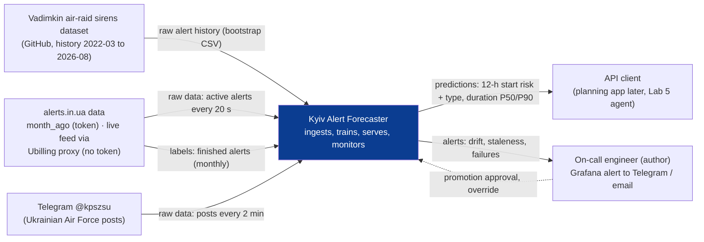
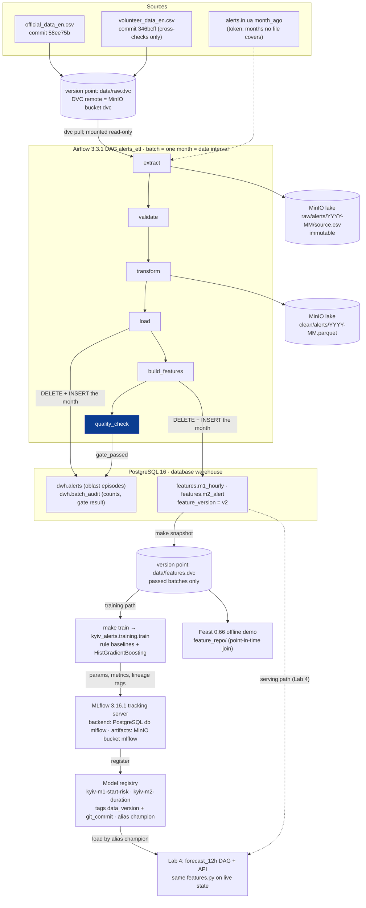
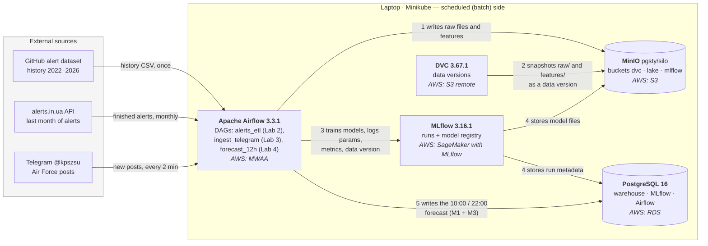
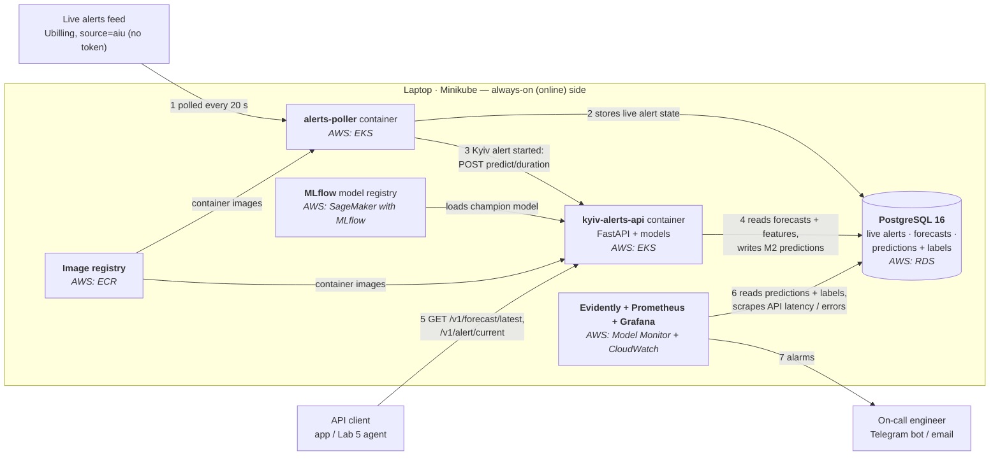

# Kyiv air-alert forecasting — design document

KSE MLOps 2026 · Lab 2 (revised 5.2–5.4, 6.1, 6.2, 6.4, 6.5, 6.8, 7.1, 7.2, 7.4) · Template: [ml-design-docs](https://github.com/eugeneyan/ml-design-docs). Section numbers are fixed; later labs revise them. **A** = assumption.

## 1 Overview

Kyiv alerts are known only when the siren starts, with no estimate of when the next one comes or how long it lasts.
The system forecasts twice a day (10:00, 22:00) the probability that a Kyiv alert starts in each of the next 12 hours, with the likely threat type, and predicts the duration (P50, P90) of every Kyiv alert when it starts.
It learns from the public alert history of all Ukraine since 2022 and the Ukrainian Air Force Telegram channel, retrains monthly and monitors drift daily.
Predictions are served by a REST API for planning only; the official alert always takes precedence.

## 2 Motivation

**What the system predicts**

| | Question it answers | When it runs | Output | Ground truth (label) and when it is known |
|---|---|---|---|---|
| **M1** start risk | "In which of the next 12 hours is a Kyiv alert likely to **start**?" | 10:00 (covers 10–22) and 22:00 (covers 22–10) | 12 probabilities, one per hour, + risk band 🟢 / 🟡 / 🔴 | 1 if a Kyiv alert started in that hour, else 0 — known at the end of the hour |
| **M3** threat type | "If an alert comes in that hour, what is it likely to be?" | together with M1 | per hour: P(drones), P(cruise missiles), P(ballistic) | type of the alert, read from Air Force Telegram posts |
| **M2** duration | "This alert just started — when will it end?" | at the start of every Kyiv alert | **P50** = typically ends by (half of such alerts end earlier) · **P90** = almost surely ends by (9 of 10 end earlier) | actual duration — known when the alert ends |

Example: at 22:00 the forecast says 00–01 h has an 11.9% chance that an alert starts (🔴, above the 6.4% average hour), and if one starts it is most likely drones (0.84). An alert then starts at 23:41 after an Air Force drone post; M2 returns P50 = 95 min and P90 = 240 min, i.e. "typically over by 01:16, almost surely by 03:41".

**Why a system, not a notebook**

- **Non-stationary target.** Nights with ≥ 60 min of alert in Kyiv: 21% (2023) → 41% (2025) → 29% (2026). Median alert duration: 55 → 30 min. Nov 2025: alerts switched from oblast to raion level. A one-off model is stale within months.
- **Consumers:** API clients (later a planning bot; the Lab 5 agent). M1: 2 forecasts/day. M2: ~1.4 predictions/day (511 Kyiv alerts in 2025).
- **Cost of errors:** a missed start → disrupted plan; frequent false alarms → forecast ignored; P90 too short → user resumes activity too early (worst case, so M2 is judged on whether P90 holds, not only on average error).

## 3 Success metrics

Lab 1 analysis below; the Lab 2 pipeline results (hold-out 2026-03-01 … 2026-08-28) are in 7.2. Hold-out 2026-03-01 … 2026-09-05. Baseline = the simplest rule a model must beat. **Main** = metric we optimise; **guardrail** = must only stay within its limit. Formulas in [README](../README.md#how-predictions-are-scored).

**M1 — is the hourly start probability good?** Scored on 4,536 hold-out hours; an alert started in 7.5% of them. Baseline = average start rate for that hour of day.

| Level | Metric | What it checks | Target | Baseline | First model |
|---|---|---|---|---|---|
| Model (main) | Brier = mean (p − y)² over hours | probabilities close to what happened (y = 1 start, 0 none); lower is better | < baseline | 0.0695 | 0.0687 |
| Model (guardrail) | AUC | start hours get higher p than quiet hours; 0.5 = random | ≥ 0.60 | 0.57 | 0.58 |
| Business | F1 with ±1 h tolerance¹ | if we flag "high risk" hours, how many real starts we catch and how many flags are right | ≥ 0.30 **A** | 0.25 | 0.27 |
| System | publish delay | forecast available after 10:00 / 22:00 | ≤ 5 min | — | — |

¹ Hours with p ≥ threshold are flagged (threshold tuned on 2025-09 … 2026-02, then frozen). A start is *caught* if its hour or a neighbouring hour was flagged; a flag is *correct* if a start fell in that hour or a neighbouring one, so "flagged 00:00, started 23:58" is a hit. F1 = 2·P·R / (P + R).

**M2 — are the duration estimates accurate and reliable?** Scored on 349 hold-out alerts. Baseline = always the last-12-months median and P90 (33 / 224 min).

| Level | Metric | What it checks | Target | Baseline |
|---|---|---|---|---|
| Model (main) | pinball loss, q = 0.5 / 0.9 | error of P50 and P90 in minutes; running past P90 costs 9× more than ending early; lower is better | < baseline | 17.3 / 20.9 |
| Business | P50 within ±15 min | share of alerts where "typically ends by" was ≤ 15 min off | ≥ 55% **A** | 47% |
| Business (guardrail) | P90 kept | share of alerts that ended before "almost surely ends by" | 85–95% | 97% |
| Business (guardrail) | P90 width | median P90 in minutes; shorter = more useful | < 224 min | 224 min |
| System | alert start → prediction (p95) | M2 arrives in time to be useful | ≤ 60 s | — |
| System | API latency (p95) | | ≤ 200 ms | — |

Why pinball is the main metric: "P90 by hour of day" is shorter (133 min) but kept less often (88%) and scores the same 20.9 as the baseline, so neither "always safe" nor "always short" wins. Results are also split by threat type and night/day (hold-out median 29 min, 29% < 20 min, 5% > 3 h).

**M3 — is the threat type right?** Scored on alerts with a known type. Macro-F1 = F1 per type, averaged, so rare ballistic alerts count as much as drones (target: "always the most common type" + 0.10 **A**); log-loss of the probabilities (target: below "last month's type mix"). Measured in Lab 3 (needs Telegram labels).

## 4 Requirements and constraints

### 4.1 Functional

| # | Requirement |
|---|---|
| F1 | Inputs: finished alert intervals (all oblasts), active alerts (poll 20 s), Air Force Telegram posts (scrape 2 min) |
| F2 | M1 + M3 at 10:00 and 22:00: 12 × {P(start), risk band, P(type \| alert)} + window summary |
| F3 | M2 at each Kyiv alert start: P50, P90, threat type used |
| F4 | Read API: `GET /v1/forecast/latest`, `/v1/alert/current`, `/v1/health`. Internal: `POST /v1/predict/duration` (poller only) |
| F5 | Every response: `model_version`, `issued_at`, `degraded`. Fallback to baseline with `degraded: true`, never an error |
| F6 | Predictions joined with labels when known; stored for monitoring and retraining |

### 4.2 Non-functional

| Category | Requirement |
|---|---|
| Freshness | M1 ≤ 5 min after issue; alert state ≤ 30 s; Telegram ≤ 5 min; labels daily (monitoring), monthly (training) |
| Latency, throughput | API p95 ≤ 200 ms; M2 ≤ 60 s p95; ≤ 10 req/s **A**; live feed (Ubilling proxy) 1 request / 20 s (limit 2 req/s); alerts.in.ua history ≤ 8 req/min (hard limit 12) |
| Availability, fallback | 99%/month on Minikube **A**; baseline fallback; live feed down or stale > 2 min → backup source `ual`, else M2 `degraded` |
| Reproducibility | model ↔ DVC data version + git commit + params in MLflow; same inputs → same metrics (fixed seeds); `uv.lock` |
| Adaptability | monthly retrain on expanding window + on alarm; new model enters as `challenger` (5.4) |
| Observability without labels | labels lag ≤ 12 h (M1), ≤ ~11 h (M2, max alert 673 min); until then: input drift, prediction drift, freshness (6.6) |
| Cost, resources | laptop, Minikube 4 GB, no GPU; cloud variant ≤ $200/month **A** (6.7) |

### 4.3 Scope

- **In:** Kyiv City; M1, M2, M3 (M3 conditional: ≥ 80% of Kyiv alerts must match a typed Air Force post, **A**, checked in Lab 3); REST API.
- **Out:** safety advice, push notifications, red/yellow alert level as target (no history; the live feed carries `alert_level`, collected by the poller from Lab 4), strike locations or air-defence data, weather (7.1).

## 5 Methodology

### 5.1 Problem statement

| | Task | Unit | Label |
|---|---|---|---|
| M1 | binary classification, probabilistic | (issue time ∈ {10, 22}, lead 0–11 h) → one model for both | a Kyiv alert **started** in the hour |
| M2 | quantile regression, q = 0.5, 0.9 | one Kyiv alert, at start | duration, minutes |
| M3 | multiclass, conditional on alert | same rows as M1 | drones / cruise missiles / ballistic, from Air Force posts (guided bombs don't reach Kyiv) |

**Hour label.** 62% of Kyiv alerts (2025–26, n = 959) cross an hour boundary.

| Alert | ≥ 10 min in hour | any minute in hour | **starts in hour** |
|---|---|---|---|
| 23:58–00:40 | 23h = 0, 00h = 1 | 23h = 1, 00h = 1 | 23h = 1 |
| 12:55–13:08 | both 0 (alert lost) | 12h = 1, 13h = 1 | 12h = 1 |
| hours = 1 | 11.8% | 14.0% | 6.4% |
| issue | 4% of alerts lost | tails and long alerts over-counted | each alert exactly once |

The 23:58 vs 00:00 boundary case is handled in evaluation by the ±1 h tolerance. Duration is M2's job.

**Rejected:** one binary "long alert tonight" label (arbitrary 60-min threshold, no timing, separate day model); duration buckets for M2 (lose the tail).

**Output, 22:00 issue.** P(start) = current baseline (2025–26 start rate by hour); type values illustrative until M3 is trained. Risk: 🟢 < 5%, 🟡 5–9%, 🔴 ≥ 9% (mean 6.4%).

| Hour | 22 | 23 | 00 | 01 | 02 | 03 | 04 | 05 | 06 | 07 | 08 | 09 |
|---|---|---|---|---|---|---|---|---|---|---|---|---|
| P(start), % | 9.3 | 10.1 | 11.9 | 10.8 | 6.4 | 8.2 | 6.2 | 4.7 | 5.1 | 4.4 | 4.2 | 6.7 |
| Risk | 🔴 | 🔴 | 🔴 | 🔴 | 🟡 | 🟡 | 🟡 | 🟢 | 🟡 | 🟢 | 🟢 | 🟡 |
| P(drones \| alert) | .80 | .82 | .84 | .82 | .75 | .60 | .45 | .40 | .35 | .30 | .25 | .25 |

```json
{
  "issued_at": "2026-10-24T22:00:00+03:00",
  "hours": [{"hour_start": "2026-10-24T22:00:00+03:00", "p_start": 0.093, "risk": "high",
             "type_if_alert": {"drones": 0.80, "cruise_missiles": 0.12, "ballistic": 0.08}}],
  "summary": {"p_any_start": 0.57, "expected_alerts": 0.88},
  "model_version": {"m1": "m1@champion:7", "m3": "m3@champion:2"},
  "degraded": false
}
```

```json
{
  "alert_started_at": "2026-10-24T23:41:10+03:00",
  "threat_type": "drones",
  "threat_source": {"post_id": 90211, "posted_at": "2026-10-24T23:36:02+03:00"},
  "duration_min": {"p50": 95, "p90": 240},
  "model_version": "m2@champion:3",
  "degraded": false
}
```

### 5.2 Data

| Source | Content | Version in use | Role |
|---|---|---|---|
| [Vadimkin dataset](https://github.com/Vadimkin/ukrainian-air-raid-sirens-dataset) `official_data_en.csv` (MIT) | official alerts, UTC, oblast / raion / hromada level; 299,275 rows, 2022-03-15 … 2026-09-07 | upstream commit `58ee75b` (2026-09-08, the last update of this file) | batches 2022-03 … 2026-08 (the only pipeline source): history, labels |
| same repo `volunteer_data_en.csv` | oblast-level alerts, `naive` = guessed end; 9.1 MB, 118,544 rows, 2022-02-25 … 2026-10-24 | upstream commit `346bcff` (2026-10-24) | cross-checks only (coarser: 1.3–1.8× more episodes), not a pipeline source |
| [alerts.in.ua API](https://devs.alerts.in.ua/) `regions/{uid}/alerts/month_ago.json` | finished alerts of the last 30 days, per oblast (25 requests, 2/min) | stored as fetched in the lake, reused on rerun | 2026-09 onwards; needs `ALERTS_IN_UA_TOKEN` |
| [Ubilling Aerial Alerts API](https://wiki.ubilling.net.ua/doku.php?id=aerialalertsapi), `?source=aiu&raw` | **active** alerts as published by alerts.in.ua, no token: `started_at` (exact, UTC), `location_type` (oblast / raion / hromada), `alert_type`, `alert_level` (red / yellow); no history, `finished_at` always null | live, checked 2026-10-25 | Lab 4 poller: M2 trigger, live features, own alert log (new batches and labels at raion level, like the official file) |
| same API, `?source=ual&raw` | the same from ukrainealarm.com (`createdAt`, `alertLevel`, `type: AIR`) | live | backup when `aiu` fails or is stale |
| Telegram [@kpszsu](https://t.me/s/kpszsu) | typed Air Force posts | — | moved to Lab 3 (with M3 and the retrieval corpus) |

**Live feed check (2026-10-25).** The proxy's `default` source (Vadym Klymenko API) returns `changed: 1970-01-01` for most regions → unusable timestamps, so the poller pins `source=aiu`. Its JSON matches the alerts.in.ua API, so switching to the direct API once the token arrives changes only the URL and auth. At the same moment the `ual` cache was ~4 min older than `aiu` → every response's `cachedat` is checked (6.6). The feed lists only active alerts: an alert's end is the first poll where it is gone (±20 s). Filters: `alert_type = air_raid`; drop permanent alerts (Luhansk since 2022-04-04, Crimea since 2022-12-10), as in the dataset. The proxy has no history, so it cannot back-fill past months: batches 2026-09 and 2026-10 wait for alerts.in.ua `month_ago`; from Lab 4 the poller's own log produces new monthly batches.

**Batch grain:** one calendar month in UTC, equal to the run's data interval (`CronDataIntervalTimetable("@monthly", timezone="UTC")`). A batch holds 1.7k–16k raw records → 0.8k–2.2k oblast episodes (official file) → 672–744 M1 rows (one per hour) and 6–135 M2 rows (one per Kyiv alert).

**Label delay:** M1 → end of the hour (a 12-h window is fully labelled 12 h after issue). M2 → end of the alert (median 38, P90 161, max 673 min). In the monthly pipeline every label of a batch is known when the batch runs, after the month ends.

**Data version identifier:** the DVC hash. Raw: `data/raw.dvc` = `352f88a87031f9e22af2cce021c2a4a7.dir` (both CSVs). Training input: `data/features.dvc` (the snapshot of the feature tables). Every MLflow run carries both as tags `raw_data_version` and `data_version`.

**Layers**

| Layer | Where | Kept | Written by |
|---|---|---|---|
| raw | DVC remote (MinIO bucket `dvc`) + lake `raw/alerts/YYYY-MM/<source>.csv` | rows as published, unified columns; immutable per batch, sha256 in the audit table | `dvc add`, task `extract` |
| clean | lake `clean/alerts/YYYY-MM.parquet` + PostgreSQL `dwh.alerts` | one row per oblast alert episode (typed, UTC) | `transform`, `load` |
| features | PostgreSQL `features.m1_hourly`, `features.m2_alert` (`feature_version` column) | one row per hour / per Kyiv alert, label alongside | `build_features` |
| training snapshot | `data/features/*.parquet`, `data/features.dvc` | batches whose gate passed | `make snapshot` |

**Cleaning rules and rows affected (2022-03 … 2026-08, official file):** 297,338 raw records → exact duplicates 113,845 (every row appears twice until 2026-01, never after) → end ≤ start 2 → unfinished 0 → raion / hromada records merged into oblast episodes 100,145 → 83,346 episodes. Guessed ends are kept for the start and flagged `end_is_guess`; M2 labels exclude them.

**Quality findings (measured):**

- The official file has a gap: nothing after 2026-08-29 05:00 UTC, while volunteer data shows ~170 alerts a day. The gate's freshness check stopped batch 2026-08 (newest alert 67 h before month end, limit 48 h). Decision: accept the 2.8 missing days for this month (`ACCEPTED_GAPS`, limit 72 h, reason stored in the gate report) and end the hold-out on 2026-08-28, so the missing hours are not scored as quiet.
- Volunteer data is coarser: for the same months it gives 1.3–1.8× more oblast episodes than the official file (2026-08: 3,916 vs 2,231). Batch 2026-09 built from it failed the size check (2.20× the median of the last 3 passed batches): a source switch the gate is meant to catch. Decision: the volunteer file is no longer a pipeline source; 2026-09 and 2026-10 come from alerts.in.ua.
- Raion-level records since Nov 2025 triple the raw rows (16k vs 4–5k a month) but not the oblast episodes (1.5k), because the transform merges them.
- Kyiv City: 2,245 alerts in 2022-03 … 2026-08; an alert started in 5.6% of hours.

**Formats:** raw CSV as published (replayable); clean and features as typed Parquet in the lake and PostgreSQL tables (point lookups, transactional delete-then-insert); training snapshot as Parquet under DVC.

**Lab checklist**

| Item | Answer |
|---|---|
| Time axis | UTC start/end since 2022-03-15; batch = calendar month (data interval) |
| Hold-out | train 2023-01 … 2026-02, hold-out 2026-03-01 … 2026-08-28 (5.4) |
| Label delay | 1–12 h (M1), ≤ 11.2 h (M2); all known when the monthly batch runs |
| Data version | DVC md5 of `data/raw.dvc` and `data/features.dvc` |
| Text surface | Air Force posts → Lab 3 |

### 5.3 Techniques

| | Trivial baseline | Rule baseline | Candidate (Lab 2) |
|---|---|---|---|
| M1 | start rate by hour of day (from the training period) | same-hour start rate over the last 30 days (feature `kyiv_rate_same_hour_30d`) | `HistGradientBoostingClassifier` on the 10 features below |
| M2 | — | last-12-months P50 / P90 of duration (before the hold-out) | two `HistGradientBoostingRegressor(loss="quantile")`, q = 0.5 / 0.9, P90 ≥ P50 enforced |
| M3 | most common type / last month's mix | type by hour of day | Lab 3 (needs Telegram labels) |

scikit-learn only: no LightGBM / XGBoost, which need `libomp` from Homebrew on macOS. Hold-out results: 7.2.

**Features and where each value comes from at serving time** (`src/kyiv_alerts/features.py`, one code path; `feature_version = v2`). The features about other regions count only Kyiv's **neighbour oblasts** — Kyivska, Zhytomyrska, Chernihivska, Cherkaska, Poltavska, Vinnytska — so front-line oblasts with near-permanent local alerts do not dominate them (v1 counted all 24). Every feature is computed as of time *t* — the issue time (M1) or the alert start (M2) — from alerts that started before *t*; an alert still running at *t* counts as active, with its minutes clipped at *t*.

| Feature | Model | Training source | Serving source (Lab 4) | Kind |
|---|---|---|---|---|
| `hour_local`, `lead`, `issue_slot`, `weekday` | M1 | computed from the hour and its issue time | computed from the request (forecast hour) | request |
| `kyiv_rate_same_hour_30d` | M1 | `dwh.alerts`, Kyiv starts in the same hour on each of the previous 30 days | same query on `dwh.alerts` + the poller's live alerts table | windowed aggregate (warehouse) |
| `kyiv_alert_min_prev_12h` | M1 | `dwh.alerts`, Kyiv alert minutes in [t − 12 h, t) | same query + the running alert from poller state | windowed aggregate (warehouse + poller) |
| `days_since_long_alert` | M1 | `dwh.alerts`, last Kyiv alert ≥ 180 min that had ended (cap 60) | same query | warehouse lookup |
| `kyiv_under_alert_at_issue` | M1 | `dwh.alerts` episodes active at t | poller state (live feed `source=aiu`, 20 s) | stream (poll) |
| `neighbours_under_alert_at_issue` | M1 | `dwh.alerts` neighbour-oblast episodes active at t (0–6) | poller state ← **skew risk**: different producer (6.6) | stream (poll) |
| `neighbour_starts_prev_12h` | M1 | `dwh.alerts`, neighbour-oblast episode starts in [t − 12 h, t) | poller history table ← **skew risk** | windowed aggregate (poller) |
| `start_hour_local`, `is_night`, `weekday` | M2 | computed from the alert start | computed from the poller's start event | request |
| `neighbours_under_alert_at_start` | M2 | `dwh.alerts` neighbour-oblast episodes active at the start | poller state ← **skew risk** | stream (poll) |
| `neighbour_starts_prev_60m` | M2 | `dwh.alerts`, neighbour-oblast starts in the last 60 min | poller history table | windowed aggregate (poller) |
| `min_since_kyivska_start` | M2 | `dwh.alerts`, last Kyiv oblast start (cap 1 week) | poller history table | windowed aggregate (poller) |
| `min_since_prev_kyiv_end`, `prev_kyiv_duration_min` | M2 | `dwh.alerts`, previous ended Kyiv alert | `dwh.alerts` + poller history | warehouse lookup |
| `kyiv_alerts_prev_7d` | M2 | `dwh.alerts`, Kyiv starts in the last 7 days | `dwh.alerts` + poller history | windowed aggregate (warehouse) |

Labels: `label_start` (M1, a Kyiv alert started in the hour) and `duration_min` (M2, `label_valid = false` when the end is a guess). Planned, not in v2: holiday and moon illumination (M1), Telegram threat features (M1, M2, M3; Lab 3).

**Point-in-time joins.** Training rows are built by the pipeline as of *t*, so no join can pull in a later row. The optional Feast demo (`feature_repo/`, 7.1) shows the same property for a feature-store lookup: a request between two issue times gets the earlier row.

### 5.4 Experimentation and validation

- **Time split only.** Attacks come in waves of several days, and neighbouring hours share the same rolling features (30-day rate, last 12 h). A random split would put hours of the same attack in train and test and score the model on a wave it has already seen.
- **Lab 2 split** (`configs/train.yaml`): train 2023-01-01 … 2026-02-28, hold-out 2026-03-01 … 2026-08-28 (4,344 hours, 325 Kyiv alerts with a valid end). 2022 is left out: early-war alerting behaved differently (raw rows halve after 2022-10). The hold-out stops before the upstream gap of 2026-08-29 … 31 (5.2).
- **F1 threshold:** tuned on 2025-09-01 … 2026-02-28 (the end of the training period), then frozen for the hold-out.
- **As-of:** features use only alerts that started before the issue time (M1) or the alert start (M2); see 5.3.
- **Metrics:** M1 Brier (main), AUC, log-loss, F1 ±1 h. M2 pinball q = 0.9 (main) and q = 0.5, P50 within ±15 min, P90 kept, P90 width.
- **Determinism:** fixed seed, early stopping off, `uv.lock`; the same commit and data version give the same metrics (reproduction tolerance in the README).
- **Later labs:** expanding-window monthly folds and the promotion rule — challenger vs champion on the last 3 monthly folds, day-level bootstrap 95% CI excluding 0, all guardrails passed, beats the rule baseline, then 1 week in shadow mode and a manual alias move.

### 5.5 Human in the loop

- Drift alarm → on-call (author) reviews the Evidently report within 24 h: ignore / retrain / fall back to baseline.
- Promotion: manual move of the MLflow alias `champion`.
- Override: `FORCE_BASELINE=true` (ConfigMap) or pin `champion` to an older version.

## 6 Implementation

### 6.1 High-level design

#### System context



#### Data flow (Lab 2, real component names)

The batch side as it runs now. Marks: **version points** (DVC: raw files, training snapshot), **quality gate** (`quality_check`, before training can read a batch), **training path** (snapshot → `kyiv_alerts.training.train`) vs **serving path** (feature code on live state, Lab 4).



- Rerunning a month is harmless: `extract` reuses the immutable raw file, and `load` / `build_features` delete and re-insert that month inside one transaction.
- Quality gate (`src/kyiv_alerts/etl/quality.py`): invalid records ≤ 1% after de-duplication; batch size within ±50% of the median of the last 3 passed batches; no duplicate (oblast, start); newest alert ≤ 48 h before month end; Kyiv present; previous month loaded (feature lookback); M1 rows = hours in the month; M2 rows = Kyiv alerts; no feature nulls; one `feature_version`. A failure marks the batch in `dwh.batch_audit`, fails the run, and keeps the batch out of the training snapshot.
- Feature store = PostgreSQL feature tables (offline + the online lookups Lab 4 needs) with a DVC-versioned Parquet snapshot for training. Feast runs as an offline demo only (7.1).
- Lab 3 adds the Telegram ingestion; Lab 4 adds the poller, the forecast DAG and the API that read the same feature code.

#### Deployment, first draft

Lab 2 runs the batch side with `docker compose` on the laptop (6.2); Lab 4 moves it to Minikube (Kubernetes 1.30.0, 4 GB) with the real cluster topology. Each box shows the local tool and, in italics, the AWS service that would replace it. Arrows read "A → B: A writes to / sends to / loads from B"; numbers give the order of a typical run. The system has two sides that share MinIO, PostgreSQL and MLflow, drawn separately for readability.

**Scheduled (batch) side** — Airflow jobs ingest data, train models and publish the 10:00 / 22:00 forecast.



**Always-on (online) side** — the poller and the API react to live alerts and serve requests; monitoring watches both.



### 6.2 Infra

Lab 2 runs as one `docker compose` project on the laptop (`docker-compose.yml`, all images arm64-native for Apple Silicon); Lab 4 moves the services to Minikube. AWS is the reference cloud because the cost estimate (6.7) is for AWS.

| Component | Local (pinned) | Compose service, host port | AWS managed equivalent |
|---|---|---|---|
| Object storage | MinIO-compatible `pgsty/silo:RELEASE.2026-09-16T00-00-00Z`; buckets `dvc`, `lake`, `mlflow` | `minio`, 9000 (S3) / 9001 (console) | Amazon S3 |
| Data versioning | DVC 3.67.1 + dvc-s3 3.3.0, remote `s3://dvc` on MinIO | host CLI (`uv run dvc`) | DVC with S3 remote |
| Warehouse, serving DB | PostgreSQL 16; databases `airflow`, `mlflow`, `warehouse` | `postgres`, 5433 | Amazon RDS for PostgreSQL |
| Orchestrator | Airflow 3.3.1, LocalExecutor (api-server, scheduler, dag-processor) | `airflow-*`, 8080 | Amazon MWAA |
| Tracking, registry | MLflow 3.16.1, PostgreSQL backend, MinIO artifacts (proxied) | `mlflow`, 5001 (macOS AirPlay holds 5000) | SageMaker with MLflow |
| Feature store | PostgreSQL tables + DVC Parquet snapshot; Feast 0.66.0 offline demo | — | SageMaker Feature Store |
| Container registry | Minikube registry (Lab 4) | — | Amazon ECR |
| Cluster (API, poller) | Minikube 1.33.1, Kubernetes 1.30.0 (Lab 4) | — | Amazon EKS |
| Model monitoring | Evidently (Lab 4) | — | SageMaker Model Monitor |
| Metrics, dashboards | Prometheus, Grafana (Lab 4) | — | Amazon CloudWatch |

Resources: Docker Desktop with ≥ 6 GB memory (the stack uses ~3 GB idle). A monthly batch runs in ~10 s; training both models takes < 30 s on CPU.

**Managed vs self-run, example (Airflow → MWAA):** gain no scheduler or database upkeep, upgrades and scaling handled by AWS; lose control over versions and plugins, and pay the largest line of the bill (6.7) for ~5 small DAGs. Hence the cost estimate assumes Airflow self-hosted on EKS.

Lab 3 adds pgvector 0.8.7 and an LLM endpoint (hosted API **A**, no local GPU).

### 6.3 Performance

- **M1 batch:** the answer changes twice a day → precompute, and the API reads a row. DAG ≤ 5 min (features ≤ 1 min, scoring < 1 s).
- **M2 online, event-triggered:** needs the alert map at the start moment. Budget ≤ 60 s p95 = 20 s poll + ≤ 5 s features + ≤ 1 s inference + feed lag (≤ 30 s **A**, measured in Lab 4).
- **Size:** ~8.8k hourly rows and ~500 alerts per year → training takes minutes on CPU. One API replica handles ≤ 10 req/s.

### 6.4 Security

- **Secrets live only in `.env`** (git-ignored; `.env.example` holds local placeholders): alerts.in.ua token (only for `month_ago` back-fill; the live feed needs none), MinIO keys, PostgreSQL passwords, Airflow JWT secret. Kubernetes Secrets in Lab 4, a cloud secret manager in the cloud variant.
- **DVC:** the remote is committed in `.dvc/config` (`s3://dvc`, endpoint only); credentials come from the environment (`AWS_ACCESS_KEY_ID` / `AWS_SECRET_ACCESS_KEY`, exported by the Makefile) and are never written to git.
- **MLflow** serves artifacts through the tracking server (`--serve-artifacts`), so training clients need no object-store credentials; `--allowed-hosts` limits the Host header to localhost and the compose network.
- **Ports bind to 127.0.0.1 only.** Airflow runs with `SIMPLE_AUTH_MANAGER_ALL_ADMINS` (no login) — acceptable on localhost, never on a shared network.
- `POST /v1/predict/duration` is reachable only from the poller (NetworkPolicy, Lab 4); cloud read endpoints use an API key + rate limit.
- alerts.in.ua terms: proxy the data and never expose the token; our API is that proxy. Ubilling asks for ≤ 2 req/s (ban risk); the poller sends 1 per 20 s.

### 6.5 Data privacy

- No personal data: alerts are public region-level events; the Air Force channel is official (no comments, no users).
- License: the Vadimkin dataset is MIT; we keep its files unchanged in the DVC remote and cite the source and commit.
- alerts.in.ua data is stored only in the private lake (raw JSON as fetched) and is not redistributed; the DVC remote is local MinIO.
- Retention: data and models until 2027-12 **A**; API logs 30 days (Lab 4). Nothing about strike locations or air defence is stored or served.

### 6.6 Monitoring and alarms

Labels arrive late, so there are four layers; only the last one needs labels.

- **Drift measures:** PSI = Σ (cur% − ref%) · ln(cur% / ref%) for numeric features. Jensen–Shannon distance for distributions (0 = identical, 1 = disjoint).
- **Reference = champion's training data**, fixed until retrain. With a rolling 90-day reference the raion-switch alarm faded after ~5 weeks.
- **Thresholds = 95th percentile of normal variation** (2025–26), alarm after 2 consecutive daily checks. The textbook PSI 0.2 would fire every few weeks here.

| Layer | Signal | Window | Threshold | Severity |
|---|---|---|---|---|
| Data health | live-feed poll failing, or response `cachedat` older than 2 min | — | > 2 min | 🔴 |
| | newest finished alert (catches re-reading one partition) | — | > 2 days | 🔴 |
| | Telegram silent / unparsed posts | — / 24 h | > 6 h / > 20% | 🟡 / 🔴 |
| | rows per batch vs 3-month median | batch | ±50% | gate fails |
| | DAG failure; M1 not published | — | any; issue + 5 min | 🔴 |
| | API p95 latency / 5xx | 15 min | > 200 ms / > 1% | 🔴 |
| Input drift | raw active records per hour (upstream signal) | 7 d | PSI > 0.5 (Nov 2025: 0.11 → 0.70 → 1.00) | 🟡 |
| | oblasts under alert | 7 d | PSI > 0.5 (normal median 0.11, p95 0.47) | 🟡 |
| | Kyiv start profile by hour of day | 30 d vs 180 d (7 d too noisy: one week = 0.34) | JS > 0.13 (normal median 0.075, p95 0.131) | 🟡 |
| | Telegram threat-type mix | 7 d | JS, calibrated in Lab 2 | 🟡 |
| | skew: live vs rebuilt oblasts under alert | 7 d | mean diff > 1 | 🟡 |
| Prediction drift | mean P(start) per issue time; share of 🔴 hours; mean P90; type mix | 7 d vs 30 d | > 50% change (type: JS > 0.1) | 🟡 |
| Performance | M1: 30-day Brier minus baseline Brier, same hours | rolling | > 0 for 14 days in a row | 🟠 |
| | M2: P90 kept, last 30 alerts | rolling | < 80%² | 🟠 |
| | M3: log-loss vs last-month mix, last 30 typed alerts | rolling | worse than baseline | 🟠 |

² If true coverage is 90%, observing < 80% in 30 alerts has probability 2.6% (false alarm); at true 75% it is caught with probability 65%.

**Routing:** Prometheus + Evidently → Grafana alert rules → Telegram bot + email. 🔴 immediately, 🟡 daily digest, 🟠 immediately with the comparison report.

| Input drift | Performance | Action |
|---|---|---|
| yes | OK | log, watch (e.g. raion switch, absorbed by aggregation) |
| yes | worse | retrain, compare (5.4), promote or `FORCE_BASELINE` |
| no | worse | concept drift: retrain, look for a new (Telegram) feature |
| data health 🔴 | any | serve baseline with `degraded: true`, fix or switch source |

### 6.7 Cost

AWS eu-central-1, monthly. **A:** rough list prices, to verify in the [AWS Pricing Calculator](https://calculator.aws/).

| Item | Sizing | USD |
|---|---|---|
| S3 + ECR | ≤ 10 GB + ≤ 1 GB | < 2 |
| RDS PostgreSQL | db.t4g.micro, 20 GB | 15–20 |
| EKS | control plane + 2 × t3.medium (API, poller, Airflow, MLflow self-hosted) | ~135 |
| CloudWatch | basic metrics, ≤ 5 GB logs | 5–10 |
| **Self-hosted total** | | **~150–170** |
| + MWAA, SageMaker MLflow, Model Monitor instead | smallest classes | + 300–570 |

The orchestrator and tracking server dominate the bill, not the model → self-hosted variant.

### 6.8 Integration points

| Party | Contract |
|---|---|
| Vadimkin dataset (upstream) | no SLA; files pinned by commit (`58ee75b` official, `346bcff` volunteer) and by DVC hash; columns `oblast, raion, hromada, level, started_at, finished_at, source` (official) / `region, started_at, finished_at, naive` (volunteer), UTC. A schema change fails `validate`; a stale or coarser file fails `quality_check` |
| alerts.in.ua (upstream) | token; ≤ 8 req/min (hard limit 12), history 2/min → 25 oblasts take ~13 min; `month_ago` covers only the last 30 days, so a month must be fetched within 30 days of its end; responses kept as fetched and replayed on rerun |
| Ubilling live feed (upstream, Lab 4) | unofficial, no SLA or terms; ≤ 2 req/s; `source` pinned to `aiu` (the unnamed `default` can switch provider); `cachedat` checked; schema change → quality gate fails |
| Air Force Telegram (upstream) | no contract; Lab 3 |
| Feature tables (internal) | `features.m1_hourly`, `features.m2_alert`, keyed by time + `feature_version`; a new version is added alongside, never overwrites; training reads the DVC snapshot, serving (Lab 4) the same tables |
| Model registry (internal → Lab 4) | names `kyiv-m1-start-risk`, `kyiv-m2-duration`; Lab 4 loads `models:/<name>@champion`; every version is tagged `data_version` and `git_commit`; clients set `MLFLOW_ENABLE_PROXY_MULTIPART_DOWNLOAD=false` |
| API clients (downstream) | versioned JSON `/v1`; `model_version`, timestamps, `degraded`; breaking changes only in `/v2` |

### 6.9 Risks and uncertainties

| Risk | Mitigation |
|---|---|
| upstream stale (official file stopped 2026-09-07) | freshness alarm; alerts.in.ua history (token); from Lab 4 the poller's own log |
| live proxy is unofficial: can stop, rate-limit or change provider | pin `source=aiu`; backup `source=ual`; `cachedat` age check; switch to direct alerts.in.ua when the token arrives (same schema) |
| permanent and non-air alerts in the live feed (Luhansk, Crimea, artillery) | filter `alert_type = air_raid`, drop permanent regions |
| upstream semantics change (raion switch) | aggregation in preprocessing; raw-record PSI |
| Telegram blocks scraping / changes markup | parser smoke test in gate; Telethon fallback |
| leakage from edited or late posts | `datetime_utc < t`; compare history vs live features in Lab 4 |
| tactics change faster than monthly retrain | daily drift + performance monitoring; on-demand retrain; baseline fallback |
| small M2 data (~500 alerts/year) | simple regularised quantile models; report intervals |
| M1 start timing barely predictable (F1 0.27 vs 0.25) | honest targets; Telegram features tested in Lab 2; baseline stays the fallback |
| token blocked for rate limits | client-side limiter 8/min, `If-Modified-Since` |

## 7 Appendix

### 7.1 Alternatives

| Alternative | Evidence / reason | Decision |
|---|---|---|
| Weather features (Open-Meteo Previous Runs, 24 h-ahead forecast) | Kyiv and Tsymbulova launch area: AUC 0.46–0.55 in every year; hold-out Brier worse than climatology | rejected |
| Hour label "≥ 10 min" / "any minute" | loses 4% of alerts / over-counts long alerts (5.1) | rejected → "starts in hour" |
| One binary label per night | arbitrary threshold, no timing | rejected → hourly M1 |
| Feast as the serving feature store | 19 features from two tables; another service on 4 GB. Its key property, point-in-time joins, is shown offline (`feature_repo/`, `make feast-demo`) | offline demo only; serving reads PostgreSQL |
| Kafka + Spark | ~1.4 Kyiv alerts/day; 20 s polling is enough | rejected |
| alerts.in.ua API directly for live alerts | official feed; needs a token (requested, not received) | Ubilling proxy (`source=aiu`, same schema) for now; switch when the token arrives |
| Telethon instead of web preview | needs a personal account and a session secret | fallback only |

### 7.2 Data pipelines, versioning and baseline

**Pipeline.** `alerts_etl` backfills 54 monthly batches (2022-03 … 2026-08) in ~7 min; all pass the gate. The first run also failed 2026-08 (official file stops 2026-08-29 05:00 UTC) and 2026-09 (volunteer source, 2.20× the 3-month median); 2026-08 was then accepted as a documented gap and 2026-09 removed (5.2). A broken copy of 2025-06 (30% of ends before starts) passed `validate` and failed `quality_check` on `invalid_share` = 0.37. Rerunning 2025-06 twice gave identical counts (1,440 episodes, 720 M1 rows, 34 M2 rows). Evidence: README §2–3.

**Experiment results** (MLflow at http://localhost:5001, experiments `kyiv-m1-start-risk` and `kyiv-m2-duration`; registered v3 of each, alias `champion`, commit `84a7cf5`; every run also carries `logging_manifest.json` and its train / hold-out datasets). Data version `183e372e0f43433c3e3e8c35624f1d44.dir` (features v2), `352f88a87031f9e22af2cce021c2a4a7.dir` (raw); train 2023-01 … 2026-02, hold-out 2026-03-01 … 2026-08-28.

| M1, 4,344 hours (start rate 7.3%) | Brier (main) | AUC | log-loss | F1 ±1 h |
|---|---|---|---|---|
| trivial: hour-of-day rate | 0.06748 | 0.568 | 0.2629 | 0.335 |
| rule: same hour, last 30 days | 0.06817 | 0.549 | 0.3423 | 0.339 |
| HistGradientBoostingClassifier | **0.06701** | **0.572** | **0.2595** | **0.345** |

| M2, 325 alerts | pinball P50 | pinball P90 (main) | P50 ±15 min | P90 kept | P90 width |
|---|---|---|---|---|---|
| rule: last-12-months 33 / 224 min | 16.13 | 21.39 | 48.9% | 97.5% | 224 min |
| quantile HistGradientBoosting | **15.68** | **15.00** | **49.8%** | **92.9%** | **136 min** |

- M1: the model beats both baselines on every metric, but only by 0.7% Brier, and AUC stays below the 0.60 guardrail. On a hold-out ending 2026-07-31 it tied the hour-of-day profile (0.05918 vs 0.05917), so the edge comes from August, the busiest month. The 5.4 promotion rule (bootstrap CI excluding 0) would likely not accept it yet; Telegram features (Lab 3) are the bet. The 30-day rule is worse than the static profile on Brier.
- M2: the model beats the rule on every metric (−30% P90 pinball, P90 88 min shorter, coverage 92.9% inside the 85–95% band). Features v1 counted all 24 oblasts and lost to the rule on P50; v2 counts only Kyiv's six neighbours, which removed the near-permanent front-line alerts from the regional features.
- Reproduction: `make reproduce` retrained both registered versions from `git_commit` and `data_version` with |Δ| = 0 on the same machine (tolerance 1e-4 Brier, 0.1 min pinball).

### 7.3 Serving, monitoring and drift

*Placeholder — Lab 4.*

### 7.4 Milestones

- **Lab 2 (done):** DVC-versioned raw data on MinIO; `alerts_etl` monthly DAG with idempotent loads and a quality gate; feature tables with `feature_version`; M1 and M2 rule baselines vs GBMs on a time split; MLflow with lineage tags, registry and `champion` alias; one-command reproduction; Feast point-in-time demo.
- **Lab 3:** Telegram ingestion (back-fill from 2024-01), threat-type parser, M3 and the Telegram features for M1/M2; LLM answers "what is the current threat to Kyiv and why this forecast", retrieving Air Force posts from pgvector; evaluated on a fixed question set.
- **Lab 4:** API + poller on Minikube with probes; forecast DAG; Evidently / Prometheus / Grafana; replayed drifts (raion switch, 2025 long nights, source switch) reach on-call.
- **Lab 5:** agent with tools (active alerts, forecast, duration, post search); traced, ten-task evaluation.
