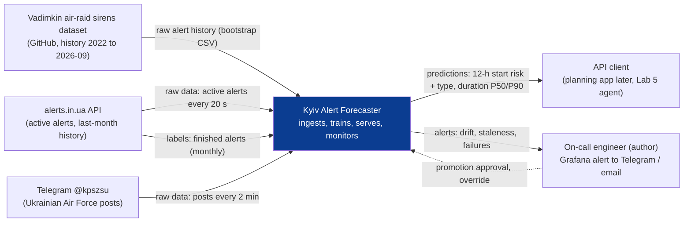
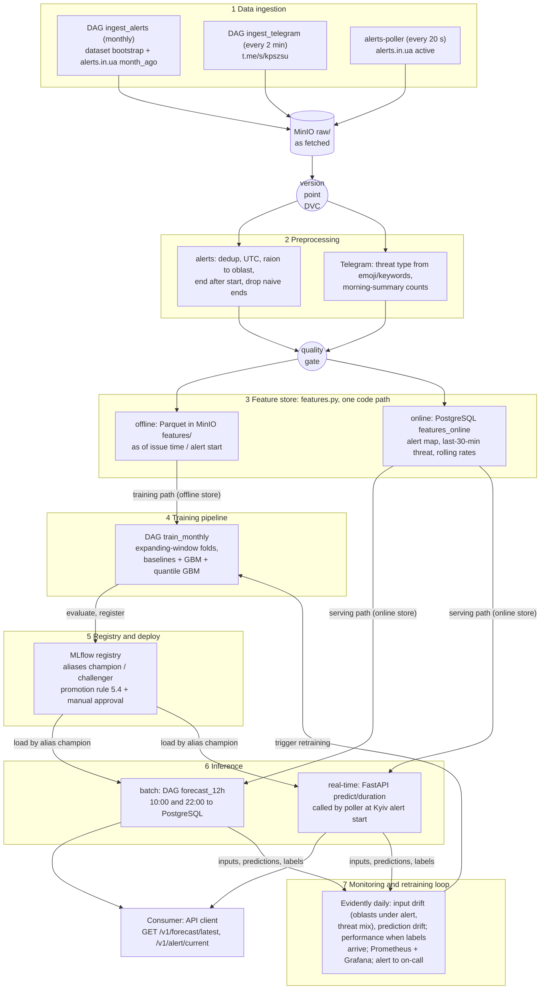
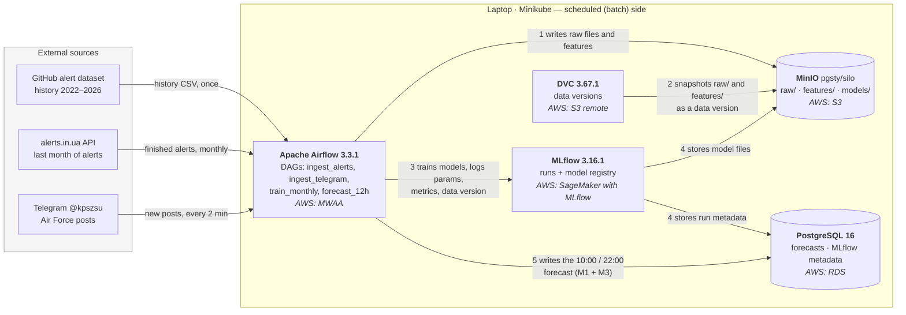
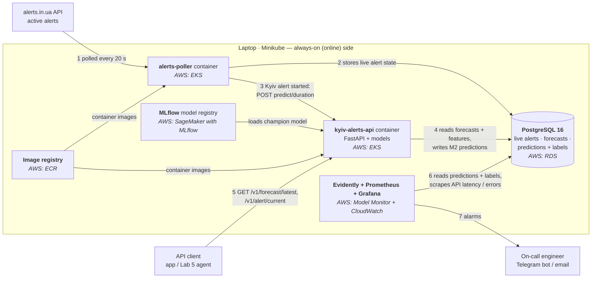

# Kyiv air-alert forecasting — design document

KSE MLOps 2026 · Lab 1 · Template: [ml-design-docs](https://github.com/eugeneyan/ml-design-docs). Section numbers are fixed; later labs revise them. **A** = assumption.

## 1 Overview

Kyiv alerts are known only when the siren starts, with no estimate of when the next one comes or how long it lasts.
The system forecasts twice a day (10:00, 22:00) the probability that a Kyiv alert starts in each of the next 12 hours, with the likely threat type, and predicts the duration (P50, P90) of every Kyiv alert when it starts.
It learns from the public alert history of all Ukraine since 2022 and the Ukrainian Air Force Telegram channel, retrains monthly and monitors drift daily.
Predictions are served by a REST API for planning only; the official alert always takes precedence.

## 2 Motivation

**What the system predicts**

| | Question it answers | When it runs | Output | Ground truth (label) and when it is known |
|---|---|---|---|---|
| **M1** start risk | "In which of the next 12 hours is a Kyiv alert likely to **start**?" | 10:00 (covers 10–22) and 22:00 (covers 22–10) | 12 probabilities, one per hour, + risk band 🟢 / 🟡 / 🔴 | 1 if a Kyiv alert started in that hour, else 0 — known at the end of the hour |
| **M3** threat type | "If an alert comes in that hour, what is it likely to be?" | together with M1 | per hour: P(drones), P(cruise missiles), P(ballistic) | type of the alert, read from Air Force Telegram posts |
| **M2** duration | "This alert just started — when will it end?" | at the start of every Kyiv alert | **P50** = typically ends by (half of such alerts end earlier) · **P90** = almost surely ends by (9 of 10 end earlier) | actual duration — known when the alert ends |

Example: at 22:00 the forecast says 00–01 h has an 11.9% chance that an alert starts (🔴, above the 6.4% average hour), and if one starts it is most likely drones (0.84). An alert then starts at 23:41 after an Air Force drone post; M2 returns P50 = 95 min and P90 = 240 min, i.e. "typically over by 01:16, almost surely by 03:41".

**Why a system, not a notebook**

- **Non-stationary target.** Nights with ≥ 60 min of alert in Kyiv: 21% (2023) → 41% (2025) → 29% (2026). Median alert duration: 55 → 30 min. Nov 2025: alerts switched from oblast to raion level. A one-off model is stale within months.
- **Consumers:** API clients (later a planning bot; the Lab 5 agent). M1: 2 forecasts/day. M2: ~1.4 predictions/day (511 Kyiv alerts in 2025).
- **Cost of errors:** a missed start → disrupted plan; frequent false alarms → forecast ignored; P90 too short → user resumes activity too early (worst case, so M2 is judged on whether P90 holds, not only on average error).

## 3 Success metrics

Hold-out 2026-03-01 … 2026-09-05. Baseline = the simplest rule a model must beat. **Main** = metric we optimise; **guardrail** = must only stay within its limit. Formulas in [README](../README.md#how-predictions-are-scored).

**M1 — is the hourly start probability good?** Scored on 4,536 hold-out hours; an alert started in 7.5% of them. Baseline = average start rate for that hour of day.

| Level | Metric | What it checks | Target | Baseline | First model |
|---|---|---|---|---|---|
| Model (main) | Brier = mean (p − y)² over hours | probabilities close to what happened (y = 1 start, 0 none); lower is better | < baseline | 0.0695 | 0.0687 |
| Model (guardrail) | AUC | start hours get higher p than quiet hours; 0.5 = random | ≥ 0.60 | 0.57 | 0.58 |
| Business | F1 with ±1 h tolerance¹ | if we flag "high risk" hours, how many real starts we catch and how many flags are right | ≥ 0.30 **A** | 0.25 | 0.27 |
| System | publish delay | forecast available after 10:00 / 22:00 | ≤ 5 min | — | — |

¹ Hours with p ≥ threshold are flagged (threshold tuned on 2025-09 … 2026-02, then frozen). A start is *caught* if its hour or the hour before was flagged; a flag is *correct* if a start fell in that hour or the next, so "flagged 00:00, started 23:58" is a hit. F1 = 2·P·R / (P + R).

**M2 — are the duration estimates accurate and reliable?** Scored on 349 hold-out alerts. Baseline = always the last-12-months median and P90 (33 / 224 min).

| Level | Metric | What it checks | Target | Baseline |
|---|---|---|---|---|
| Model (main) | pinball loss, q = 0.5 / 0.9 | error of P50 and P90 in minutes; running past P90 costs 9× more than ending early; lower is better | < baseline | 17.3 / 20.9 |
| Business | P50 within ±15 min | share of alerts where "typically ends by" was ≤ 15 min off | ≥ 55% **A** | 47% |
| Business (guardrail) | P90 kept | share of alerts that ended before "almost surely ends by" | 85–95% | 97% |
| Business (guardrail) | P90 width | median P90 in minutes; shorter = more useful | < 224 min | 224 min |
| System | alert start → prediction (p95) | M2 arrives in time to be useful | ≤ 60 s | — |
| System | API latency (p95) | | ≤ 200 ms | — |

Why pinball is the main metric: "P90 by hour of day" is shorter (133 min) but kept less often (88%) and scores the same 20.9 as the baseline, so neither "always safe" nor "always short" wins. Results are also split by threat type and night/day (hold-out median 29 min, 29% < 20 min, 5% > 3 h).

**M3 — is the threat type right?** Scored on alerts with a known type. Macro-F1 = F1 per type, averaged, so rare ballistic alerts count as much as drones (target: "always the most common type" + 0.10 **A**); log-loss of the probabilities (target: below "last month's type mix"). Measured in Lab 2.

## 4 Requirements and constraints

### 4.1 Functional

| # | Requirement |
|---|---|
| F1 | Inputs: finished alert intervals (all oblasts), active alerts (poll 20 s), Air Force Telegram posts (scrape 2 min) |
| F2 | M1 + M3 at 10:00 and 22:00: 12 × {P(start), risk band, P(type \| alert)} + window summary |
| F3 | M2 at each Kyiv alert start: P50, P90, threat type used |
| F4 | Read API: `GET /v1/forecast/latest`, `/v1/alert/current`, `/v1/health`. Internal: `POST /v1/predict/duration` (poller only) |
| F5 | Every response: `model_version`, `issued_at`, `degraded`. Fallback to baseline with `degraded: true`, never an error |
| F6 | Predictions joined with labels when known; stored for monitoring and retraining |

### 4.2 Non-functional

| Category | Requirement |
|---|---|
| Freshness | M1 ≤ 5 min after issue; alert state ≤ 30 s; Telegram ≤ 5 min; labels daily (monitoring), monthly (training) |
| Latency, throughput | API p95 ≤ 200 ms; M2 ≤ 60 s p95; ≤ 10 req/s **A**; alerts.in.ua ≤ 8 req/min (hard limit 12) |
| Availability, fallback | 99%/month on Minikube **A**; baseline fallback; alerts.in.ua down > 2 min → M2 `degraded` |
| Reproducibility | model ↔ DVC data version + git commit + params in MLflow; same inputs → same metrics (fixed seeds); `uv.lock` |
| Adaptability | monthly retrain on expanding window + on alarm; new model enters as `challenger` (5.4) |
| Observability without labels | labels lag ≤ 12 h (M1), ≤ ~11 h (M2, max alert 673 min); until then: input drift, prediction drift, freshness (6.6) |
| Cost, resources | laptop, Minikube 4 GB, no GPU; cloud variant ≤ $200/month **A** (6.7) |

### 4.3 Scope

- **In:** Kyiv City; M1, M2, M3 (M3 conditional: ≥ 80% of Kyiv alerts must match a typed Air Force post, **A**, checked in Lab 2); REST API.
- **Out:** safety advice, push notifications, red/yellow alert level as target (no history; collected from Lab 2), strike locations or air-defence data, weather (7.1).

## 5 Methodology

### 5.1 Problem statement

| | Task | Unit | Label |
|---|---|---|---|
| M1 | binary classification, probabilistic | (issue time ∈ {10, 22}, lead 0–11 h) → one model for both | a Kyiv alert **started** in the hour |
| M2 | quantile regression, q = 0.5, 0.9 | one Kyiv alert, at start | duration, minutes |
| M3 | multiclass, conditional on alert | same rows as M1 | drones / cruise missiles / ballistic, from Air Force posts (guided bombs don't reach Kyiv) |

**Hour label.** 62% of Kyiv alerts (2025–26, n = 959) cross an hour boundary.

| Alert | ≥ 10 min in hour | any minute in hour | **starts in hour** |
|---|---|---|---|
| 23:58–00:40 | 23h = 0, 00h = 1 | 23h = 1, 00h = 1 | 23h = 1 |
| 12:55–13:08 | both 0 (alert lost) | 12h = 1, 13h = 1 | 12h = 1 |
| hours = 1 | 11.8% | 14.0% | 6.4% |
| issue | 4% of alerts lost | tails and long alerts over-counted | each alert exactly once |

The 23:58 vs 00:00 boundary case is handled in evaluation by the ±1 h tolerance. Duration is M2's job.

**Rejected:** one binary "long alert tonight" label (arbitrary 60-min threshold, no timing, separate day model); duration buckets for M2 (lose the tail).

**Output, 22:00 issue.** P(start) = current baseline (2025–26 start rate by hour); type values illustrative until M3 is trained. Risk: 🟢 < 5%, 🟡 5–9%, 🔴 ≥ 9% (mean 6.4%).

| Hour | 22 | 23 | 00 | 01 | 02 | 03 | 04 | 05 | 06 | 07 | 08 | 09 |
|---|---|---|---|---|---|---|---|---|---|---|---|---|
| P(start), % | 9.3 | 10.1 | 11.9 | 10.8 | 6.4 | 8.2 | 6.2 | 4.7 | 5.1 | 4.4 | 4.2 | 6.7 |
| Risk | 🔴 | 🔴 | 🔴 | 🔴 | 🟡 | 🟡 | 🟡 | 🟢 | 🟡 | 🟢 | 🟢 | 🟡 |
| P(drones \| alert) | .80 | .82 | .84 | .82 | .75 | .60 | .45 | .40 | .35 | .30 | .25 | .25 |

```json
{
  "issued_at": "2026-10-24T22:00:00+03:00",
  "hours": [{"hour_start": "2026-10-24T22:00:00+03:00", "p_start": 0.093, "risk": "high",
             "type_if_alert": {"drones": 0.80, "cruise_missiles": 0.12, "ballistic": 0.08}}],
  "summary": {"p_any_start": 0.57, "expected_alerts": 0.88},
  "model_version": {"m1": "m1@champion:7", "m3": "m3@champion:2"},
  "degraded": false
}
```

```json
{
  "alert_started_at": "2026-10-24T23:41:10+03:00",
  "threat_type": "drones",
  "threat_source": {"post_id": 90211, "posted_at": "2026-10-24T23:36:02+03:00"},
  "duration_min": {"p50": 95, "p90": 240},
  "model_version": "m2@champion:3",
  "degraded": false
}
```

### 5.2 Data

| Source | Content | Arrival | Role |
|---|---|---|---|
| [Vadimkin dataset](https://github.com/Vadimkin/ukrainian-air-raid-sirens-dataset) `official_data_en.csv` (MIT) | all official alerts since 2022-03-15, UTC, oblast / raion / hromada | bootstrap; our copy ends 2026-09-07 | history, labels |
| same repo `volunteer_data_en.csv` | oblast-level alerts since 2022-02-25 | current (2026-10-23) | cross-check, gap fill |
| [alerts.in.ua API](https://devs.alerts.in.ua/) | active alerts; last month of finished alerts | poll 20 s; monthly batch | serving features, new batches, labels |
| Telegram [@kpszsu](https://t.me/s/kpszsu) web preview | typed posts (emoji + threat + location + heading), morning attack summaries | scrape 2 min; back-fill from 2024-01-01 | M1/M3 features, M3 labels, M2 threat type, Lab 3 corpus |

**Label delay:** M1 → end of the hour (window fully labelled after 12 h). M2 → end of the alert (median 38, P90 161, P99 440, max 673 min). M3 → first matching post.

**Training vs serving**

| | Training | Serving |
|---|---|---|
| Alert intervals | complete (start + end) | only starts; ends arrive later |
| Oblasts under alert at *t* | rebuilt from dataset intervals | alerts.in.ua snapshot (different producer) |
| Telegram text | scraped history, possibly edited | first-published text |

**Quality findings (measured):**

- 38% exact duplicate rows (113,845). Kyiv: 4,141 rows → 2,267 alerts after dedup.
- The official file stopped on 2026-09-07 despite "updated daily".
- Raion-level since Nov 2025: active records 18.7 → 28.9 per hour, but oblasts under alert unchanged (6.2 → 6.4) after raion → oblast aggregation.
- 8.6% of volunteer Kyiv rows have a guessed end (`naive=True`) → excluded from M2 labels.
- Official and volunteer yearly counts agree within ~5% (2023–25).

**Formats:** raw as fetched (CSV / JSON) in MinIO `raw/`, immutable → replayable. Clean and features: Parquet (typed, columnar, fast time scans). Serving: PostgreSQL (point lookups, transactional poller writes).

**Lab checklist**

| Item | Answer |
|---|---|
| Time axis | UTC start/end since 2022; posts timestamped. Monthly batch = alerts.in.ua `month_ago` + new posts. Real drift to replay in Lab 4: raion switch, 2025 rise in long nights |
| Hold-out | 4.5 years; hold-out 2026-03-01 … 2026-08-31. Telegram models train 2024-01 … 2026-02 |
| Label delay | 1–12 h (M1), ≤ 11.2 h (M2) |
| Text surface | Air Force posts + morning summaries → Lab 3 retrieval corpus |

### 5.3 Techniques

| | Trivial baseline | Rule baseline | Candidate |
|---|---|---|---|
| M1 | start rate by hour of day: Brier 0.0695, F1 0.25 | same-hour start rate, last 30 days | GBM (LightGBM / HistGradientBoosting). History-only: Brier 0.0687, F1 0.27 — barely better; Telegram features are the bet |
| M2 | last-12-months P50 / P90: pinball 17.3 / 20.9 | by threat type at start (ballistic short, drones long) — Lab 2 | quantile GBM. Naive version: MAE 45.1 (worse; drift + raion switch) |
| M3 | most common type / last month's mix | type by hour of day | multiclass GBM |

**Features** (one `features.py` for offline and online)

| Feature | Model | Training source | Serving source |
|---|---|---|---|
| hour, lead, issue time, weekday, holiday, moon illumination | M1 | computed | computed |
| same-hour start rate, 30 d; minutes of alert in previous window; days since last ≥ 180-min night | M1 | clean alert Parquet | PostgreSQL alert table |
| Kyiv under alert now | M1 | rebuilt at *t* | poller state |
| **oblasts under alert now** (raions → oblasts) | M1, M2 | dataset intervals | **alerts.in.ua snapshot** ← skew risk |
| oblasts started alert in last 5 / 60 min; minutes since Kyiv oblast alert; minutes since previous Kyiv alert | M2 | dataset intervals | poller history |
| Air Force posts per threat type in last 6 / 12 h; Kyiv mentions; last night's drone and missile counts | M1, M3 | scraped posts, `datetime_utc < t` | live ingest ← skew risk (edits) |
| threat type in 30 min before alert start | M2 | scraped posts | live ingest |

### 5.4 Experimentation and validation

- **Time split only.** Attacks come in waves; a random split leaks the same attack into train and test.
- **Folds:** expanding window, monthly test folds. Final hold-out 2026-03-01 … 2026-08-31, used once per model family.
- **As-of:** features use only data with timestamp < issue time (M1) or < alert start (M2).
- **Metrics:** M1 Brier, AUC, F1 ±1 h, calibration, Brier per lead. M2 pinball 0.5 / 0.9, ±15 min, P90 kept, P90 width, per threat type and night/day. M3 log-loss, macro-F1.
- **Promotion:** challenger vs champion on the last 3 monthly folds. It must win on the main metric with a day-level bootstrap 95% CI excluding 0, pass all guardrails, and beat the rule baseline. Then 1 week in shadow mode, then manual promotion.

### 5.5 Human in the loop

- Drift alarm → on-call (author) reviews the Evidently report within 24 h: ignore / retrain / fall back to baseline.
- Promotion: manual move of the MLflow alias `champion`.
- Override: `FORCE_BASELINE=true` (ConfigMap) or pin `champion` to an older version.

## 6 Implementation

### 6.1 High-level design

#### System context



#### Data flow on the seven layers

Marks: **version point** (DVC snapshot of `raw/`), **quality gate** (before the feature store), **training path** (offline store) vs **serving path** (online store).



- The poller runs the same preprocessing and feature code before writing the online store, so there is no separate streaming stack.
- Quality gate: no duplicates after dedup; end > start; newest event < 2 days old; rows within ±50% of the 3-month median; every raion mapped to an oblast; Telegram silent ≤ 6 h. A failure stops the run and alerts on-call.
- Feature store = Parquet (offline) + PostgreSQL (online), no Feast (7.1).

#### Deployment, first draft

Everything runs on one laptop in Minikube (Kubernetes 1.30.0, 4 GB); Lab 4 replaces this with the real cluster topology. Each box shows the local tool and, in italics, the AWS service that would replace it. Arrows read "A → B: A writes to / sends to / loads from B"; numbers give the order of a typical run. The system has two sides that share MinIO, PostgreSQL and MLflow, drawn separately for readability.

**Scheduled (batch) side** — Airflow jobs ingest data, train models and publish the 10:00 / 22:00 forecast.



**Always-on (online) side** — the poller and the API react to live alerts and serve requests; monitoring watches both.



### 6.2 Infra

Local stack (versions pinned as in the course reference table) and the AWS service that would replace each component. AWS is used because the cost estimate (6.7) is for AWS.

| Component | Local (pinned) | AWS managed equivalent |
|---|---|---|
| Object storage | MinIO-compatible `pgsty/silo:RELEASE.2026-09-16T00-00-00Z` | Amazon S3 |
| Data versioning | DVC 3.67.1 + dvc-s3 3.3.0, remote on MinIO | DVC with S3 remote |
| Serving DB | PostgreSQL 16 | Amazon RDS for PostgreSQL |
| Orchestrator | Airflow 3.3.1, LocalExecutor | Amazon MWAA |
| Tracking, registry | MLflow 3.16.1 (PostgreSQL + MinIO) | SageMaker with MLflow |
| Feature store | Parquet + PostgreSQL (no Feast) | SageMaker Feature Store |
| Container registry | Minikube registry | Amazon ECR |
| Cluster (API, poller) | Minikube 1.33.1, Kubernetes 1.30.0 | Amazon EKS |
| Model monitoring | Evidently | SageMaker Model Monitor |
| Metrics, dashboards | Prometheus, Grafana | Amazon CloudWatch |

**Managed vs self-run, example (Airflow → MWAA):** gain no scheduler or database upkeep, upgrades and scaling handled by AWS; lose control over versions and plugins, and pay the largest line of the bill (6.7) for ~5 small DAGs. Hence the cost estimate assumes Airflow self-hosted on EKS.

The table and the diagrams name the same components. Lab 3 adds pgvector 0.8.7 and an LLM endpoint (hosted API **A**, no local GPU) to both.

### 6.3 Performance

- **M1 batch:** the answer changes twice a day → precompute, and the API reads a row. DAG ≤ 5 min (features ≤ 1 min, scoring < 1 s).
- **M2 online, event-triggered:** needs the alert map at the start moment. Budget ≤ 60 s p95 = 20 s poll + ≤ 5 s features + ≤ 1 s inference + feed lag (≤ 30 s **A**, measured in Lab 4).
- **Size:** ~8.8k hourly rows and ~500 alerts per year → training takes minutes on CPU. One API replica handles ≤ 10 req/s.

### 6.4 Security

- Only secret: alerts.in.ua token. Kept in `.env` (git-ignored) → Kubernetes Secret → cloud secret manager.
- `POST /v1/predict/duration` is reachable only from the poller (NetworkPolicy). Cloud read endpoints use an API key + rate limit.
- alerts.in.ua terms: proxy the data and never expose the token; our API is that proxy.

### 6.5 Data privacy

- No personal data: alerts are public region-level events; posts come from an official channel (no comments, no users).
- Retention: data and models until 2027-12 **A**; API logs 30 days. Nothing about strike locations or air defence is stored or served.

### 6.6 Monitoring and alarms

Labels arrive late, so there are four layers; only the last one needs labels.

- **Drift measures:** PSI = Σ (cur% − ref%) · ln(cur% / ref%) for numeric features. Jensen–Shannon distance for distributions (0 = identical, 1 = disjoint).
- **Reference = champion's training data**, fixed until retrain. With a rolling 90-day reference the raion-switch alarm faded after ~5 weeks.
- **Thresholds = 95th percentile of normal variation** (2025–26), alarm after 2 consecutive daily checks. The textbook PSI 0.2 would fire every few weeks here.

| Layer | Signal | Window | Threshold | Severity |
|---|---|---|---|---|
| Data health | alerts.in.ua poll failing | — | > 2 min | 🔴 |
| | newest finished alert (catches re-reading one partition) | — | > 2 days | 🔴 |
| | Telegram silent / unparsed posts | — / 24 h | > 6 h / > 20% | 🟡 / 🔴 |
| | rows per batch vs 3-month median | batch | ±50% | gate fails |
| | DAG failure; M1 not published | — | any; issue + 5 min | 🔴 |
| | API p95 latency / 5xx | 15 min | > 200 ms / > 1% | 🔴 |
| Input drift | raw active records per hour (upstream signal) | 7 d | PSI > 0.5 (Nov 2025: 0.11 → 0.70 → 1.00) | 🟡 |
| | oblasts under alert | 7 d | PSI > 0.5 (normal median 0.11, p95 0.47) | 🟡 |
| | Kyiv start profile by hour of day | 30 d vs 180 d (7 d too noisy: one week = 0.34) | JS > 0.13 (normal median 0.075, p95 0.131) | 🟡 |
| | Telegram threat-type mix | 7 d | JS, calibrated in Lab 2 | 🟡 |
| | skew: live vs rebuilt oblasts under alert | 7 d | mean diff > 1 | 🟡 |
| Prediction drift | mean P(start) per issue time; share of 🔴 hours; mean P90; type mix | 7 d vs 30 d | > 50% change (type: JS > 0.1) | 🟡 |
| Performance | M1: 30-day Brier minus baseline Brier, same hours | rolling | > 0 for 14 days in a row | 🟠 |
| | M2: P90 kept, last 30 alerts | rolling | < 80%² | 🟠 |
| | M3: log-loss vs last-month mix, last 30 typed alerts | rolling | worse than baseline | 🟠 |

² If true coverage is 90%, observing < 80% in 30 alerts has probability 2.6% (false alarm); at true 75% it is caught with probability 65%.

**Routing:** Prometheus + Evidently → Grafana alert rules → Telegram bot + email. 🔴 immediately, 🟡 daily digest, 🟠 immediately with the comparison report.

| Input drift | Performance | Action |
|---|---|---|
| yes | OK | log, watch (e.g. raion switch, absorbed by aggregation) |
| yes | worse | retrain, compare (5.4), promote or `FORCE_BASELINE` |
| no | worse | concept drift: retrain, look for a new (Telegram) feature |
| data health 🔴 | any | serve baseline with `degraded: true`, fix or switch source |

### 6.7 Cost

AWS eu-central-1, monthly. **A:** rough list prices, to verify in the [AWS Pricing Calculator](https://calculator.aws/).

| Item | Sizing | USD |
|---|---|---|
| S3 + ECR | ≤ 10 GB + ≤ 1 GB | < 2 |
| RDS PostgreSQL | db.t4g.micro, 20 GB | 15–20 |
| EKS | control plane + 2 × t3.medium (API, poller, Airflow, MLflow self-hosted) | ~135 |
| CloudWatch | basic metrics, ≤ 5 GB logs | 5–10 |
| **Self-hosted total** | | **~150–170** |
| + MWAA, SageMaker MLflow, Model Monitor instead | smallest classes | + 300–570 |

The orchestrator and tracking server dominate the bill, not the model → self-hosted variant.

### 6.8 Integration points

| Party | Contract |
|---|---|
| Vadimkin dataset (upstream) | best effort, no SLA; CSV `oblast, raion, hromada, level, started_at, finished_at, source`, UTC; dedup + freshness check |
| alerts.in.ua (upstream) | token; ≤ 8 req/min (hard limit 12), history 2/min; must proxy; schema change → quality gate fails |
| Air Force Telegram (upstream) | no contract; format can change → versioned parser, unparsed share monitored |
| API clients (downstream) | versioned JSON `/v1`; `model_version`, timestamps, `degraded`; breaking changes only in `/v2` |

### 6.9 Risks and uncertainties

| Risk | Mitigation |
|---|---|
| upstream stale (official file stopped 2026-09-07) | freshness alarm; volunteer data + alerts.in.ua history |
| upstream semantics change (raion switch) | aggregation in preprocessing; raw-record PSI |
| Telegram blocks scraping / changes markup | parser smoke test in gate; Telethon fallback |
| leakage from edited or late posts | `datetime_utc < t`; compare history vs live features in Lab 4 |
| tactics change faster than monthly retrain | daily drift + performance monitoring; on-demand retrain; baseline fallback |
| small M2 data (~500 alerts/year) | simple regularised quantile models; report intervals |
| M1 start timing barely predictable (F1 0.27 vs 0.25) | honest targets; Telegram features tested in Lab 2; baseline stays the fallback |
| token blocked for rate limits | client-side limiter 8/min, `If-Modified-Since` |

## 7 Appendix

### 7.1 Alternatives

| Alternative | Evidence / reason | Decision |
|---|---|---|
| Weather features (Open-Meteo Previous Runs, 24 h-ahead forecast) | Kyiv and Tsymbulova launch area: AUC 0.46–0.55 in every year; hold-out Brier worse than climatology | rejected |
| Hour label "≥ 10 min" / "any minute" | loses 4% of alerts / over-counts long alerts (5.1) | rejected → "starts in hour" |
| One binary label per night | arbitrary threshold, no timing | rejected → hourly M1 |
| Feast | ~15 features from two tables; another service on 4 GB | rejected for now |
| Kafka + Spark | ~1.4 Kyiv alerts/day; 20 s polling is enough | rejected |
| Telethon instead of web preview | needs a personal account and a session secret | fallback only |

### 7.2 Data pipelines, versioning and baseline

*Placeholder — Lab 2.*

### 7.3 Serving, monitoring and drift

*Placeholder — Lab 4.*

### 7.4 Milestones

- **Lab 2:** ingestion DAGs (alerts, Telegram), DVC, quality gate, baselines and first M1/M2/M3 models in MLflow on time folds; M3 label match-rate check.
- **Lab 3:** LLM answers "what is the current threat to Kyiv and why this forecast", retrieving Air Force posts from pgvector; evaluated on a fixed question set.
- **Lab 4:** API + poller on Minikube with probes; Evidently / Prometheus / Grafana; replayed drifts (raion switch, 2025 long nights, Telegram format change) reach on-call.
- **Lab 5:** agent with tools (active alerts, forecast, duration, post search); traced, ten-task evaluation.
